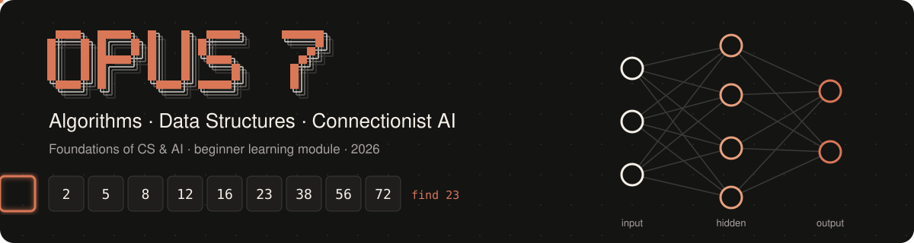

<p align="center">
  
</p>

<p align="center"><b>A beginner's path from step-by-step algorithms, to the data structures that hold information, to neural networks that learn from examples.</b></p>

---

## About this project

| | |
|---|---|
| **Course** | Foundations of CS & AI (2026) |
| **Team** | Opus 7 |
| **Module** | Algorithms, Data Structures & Connectionist AI |
| **Intended learners** | First-year university students with no prior computer science or AI background |
| **Deliverables** | Study Guide · PPT Slides · Video Tutorials (all built from the Markdown in this repo) |

**Purpose.** This repository holds the shared learning content for our module. Every explanation, example, activity and reference is written here in Markdown first, checked, and then turned into the study guide, slides and videos. When something is corrected here, every deliverable is updated from it.

## Team

| Member | Role | GitHub |
|---|---|---|
| Amadeus Kenzie Solihin | Repository lead (CIO), Quality lead | [@MyBoyAKS](https://github.com/MyBoyAKS) |
| Derren Manuel Natalis | Coordinator (CEO), Repository & submission lead (CIO) | [@derrenmn](https://github.com/derrenmn) |
| Antony Wijaya | Content lead, Quality lead | [@AntonyWijaya28](https://github.com/AntonyWijaya28) |
| Cristo Berlino | Visual design lead, Video lead | [@CristoBerlin](https://github.com/CristoBerlin) |
| Nicholas Chung | Content | [@mucsoop](https://github.com/mucsoop) |

## Start here

1. Read the [module outline](content/00_module_outline.md) (10 minutes).
2. Read the chapters in order: [Part 1](content/01_algorithms/README.md), [Part 2](content/02_data_structures/README.md), [Part 3](content/03_connectionist_ai/README.md).
3. In each chapter: predict first, do the activity on paper or on the platform, then read the answers.
4. Test yourself with the [Test Bank](test_bank/).

**You need:** a web browser or any Markdown viewer. Python examples are optional.

## Folder structure

```
.
├── README.md                 ← you are here
├── assets/                   ← images, diagrams, banner
├── content/                  ← the learning material (Markdown)
│   ├── 00_module_outline.md  ← start here
│   ├── 01_algorithms/        ← Part 1 (each .md file is a chapter)
│   ├── 02_data_structures/   ← Part 2
│   └── 03_connectionist_ai/  ← Part 3
├── game/                     ← optional learning game (open index.html)
├── plan/                     ← project plan and task list
├── references/               ← sources and image credits
└── test_bank/                ← questions and answer keys
```

## Current progress

Status labels: ✅ checked by a reviewer · 📝 drafted · 🔲 outline only

| Part | Status |
|---|---|
| Repository setup and README | ✅ Done |
| [Module outline](content/00_module_outline.md) | ✅ Updated to parts, chapters and sections (3.5 is a new chapter in Stage 3) |
| 01 Algorithms | ✅ [1.1](content/01_algorithms/1.1_what-is-an-algorithm.md) · ✅ [1.2](content/01_algorithms/1.2_representing-algorithms.md) · ✅ [1.3](content/01_algorithms/1.3_searching.md) · ✅ [1.4](content/01_algorithms/1.4_sorting.md) · ✅ [1.5](content/01_algorithms/1.5_iteration-vs-recursion.md) |
| 02 Data structures | ✅ [2.1](content/02_data_structures/2.1_arrays-and-records.md) · ✅ [2.2](content/02_data_structures/2.2_linked-lists.md) · ✅ [2.3](content/02_data_structures/2.3_stacks-and-queues.md) · ✅ [2.4](content/02_data_structures/2.4_trees-and-binary-trees.md) · ✅ [2.5](content/02_data_structures/2.5_graphs.md) |
| 03 Connectionist AI | ✅ [3.1](content/03_connectionist_ai/3.1_connectionist-vs-symbolic-ai.md) · ✅ [3.2](content/03_connectionist_ai/3.2_perceptron.md) · ✅ [3.3](content/03_connectionist_ai/3.3_how-networks-learn.md) · ✅ [3.4](content/03_connectionist_ai/3.4_architectures-and-deep-learning.md) · 📝 [3.5](content/03_connectionist_ai/3.5_key-applications.md) · ✅ [3.6](content/03_connectionist_ai/3.6_ethics-and-challenges.md) |
| [Test Bank](test_bank/) | ✅ Part 1, Part 2, Part 3: 21 true/false, 21 multiple choice, 6 open |
| Project plan and [task list](plan/master_task_list.md) | ✅ Updated 7 Nov 2026 |

**Organization:** parts (folders) → chapters (files) → sections (numbered `##` headings).

## Version and known limits

| | |
|---|---|
| **Version** | Final V3.0 (Stage 3, 28 November 2026). This is the version submitted for assessment. |
| **Not in this repository** | Study Guide, slides and videos. They are submitted separately on Lexue. |
| **Known limits** | Big Data is only context. Mathematics of backpropagation is not covered. Online labs need internet, each has a paper fallback. |
