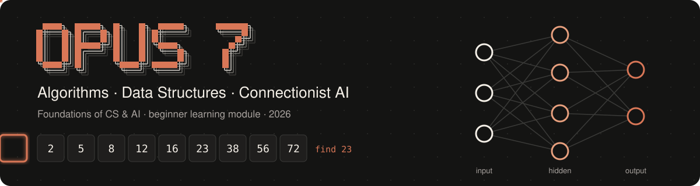

<p align="center">
  
</p>

<p align="center"><b>A beginner's path from step-by-step algorithms, to the data structures that hold information, to neural networks that learn from examples.</b></p>

---

## About this project

| | |
|---|---|
| **Course** | Foundations of CS & AI (2026) |
| **Team** | Opus 7 |
| **Module** | Algorithms, Data Structures & Connectionist AI |
| **Intended learners** | First-year university students with no prior computer science or AI background |
| **Deliverables** | Study Guide · PPT Slides · Video Tutorials (all built from the Markdown in this repo) |

**Purpose.** This repository holds the shared learning content for our module. Every explanation, example, activity and reference is written here in Markdown first, checked, and then turned into the study guide, slides and videos. When something is corrected here, every deliverable is updated from it.

## Team

| Member | Role | GitHub |
|---|---|---|
| Amadeus Kenzie Solihin | Coordinator (CEO), Quality lead | [@MyBoyAKS](https://github.com/MyBoyAKS) |
| Derren Manuel Natalis | Repository & submission lead (CIO) | [@derrenmn](https://github.com/derrenmn) |
| Antony Wijaya | Content lead, Quality lead | [@AntonyWijaya28](https://github.com/AntonyWijaya28) |
| Cristo Berlino | Visual design lead, Video lead | TBA |
| Nicholas Chung | Content | [@mucsoop](https://github.com/mucsoop) |

## Folder structure

```
.
├── README.md                 ← you are here
├── assets/                   ← images, diagrams, banner
├── content/                  ← the learning material (Markdown)
│   ├── 00_module_outline.md  ← start here
│   ├── 01_algorithms/
│   ├── 02_data_structures/
│   └── 03_connectionist_ai/
├── plan/                     ← project plan and task list
└── references/               ← sources we used
```

## Current progress

Status labels: ✅ checked by a reviewer · 📝 drafted · 🔲 outline only

| Part | Status |
|---|---|
| Repository setup and README | ✅ Done |
| [Module outline](content/00_module_outline.md) | 📝 Drafted |
| 01 Algorithms | ✅ [1.1 What is an algorithm](content/01_algorithms/1.1_what-is-an-algorithm.md) · ✅ [1.3 Searching](content/01_algorithms/1.3_searching.md) (fully developed topic) · 🔲 1.2, 1.4, 1.5 |
| 02 Data structures | ✅ [2.3 Stacks and queues](content/02_data_structures/2.3_stacks-and-queues.md) · 🔲 2.1, 2.2, 2.4, 2.5 |
| 03 Connectionist AI | 📝 3.2 The perceptron (in review) · 🔲 3.1, 3.3 to 3.6 |
| Project plan and task list | 📝 In progress |

**Next:** 3.2 and diagrams, then Content V1.0 submission (24 Oct 2026). Stage 2: study guide, slides and videos built from this Markdown.
