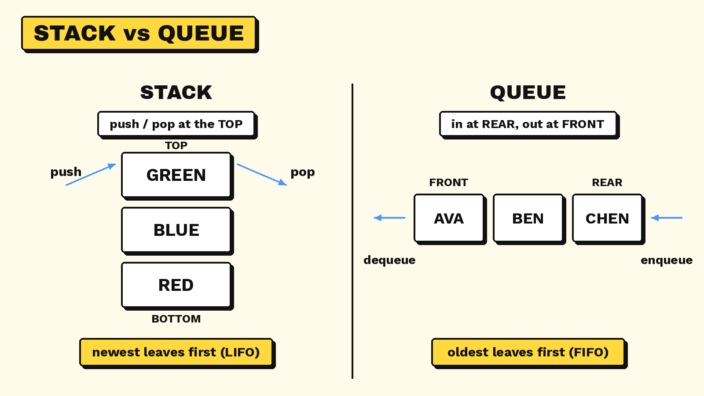

# 2.3 Stacks and Queues

> **Part:** 02 Data Structures  
> **Author:** Antony Wijaya  
> **Reviewer:** Amadeus Kenzie Solihin

## Learning goals

After studying this section, beginners should be able to:

1. Explain what a data structure is and why stacks and queues are useful.
2. Describe the **LIFO** rule used by a stack and the **FIFO** rule used by a queue.
3. Identify the main operations for each structure and predict their results.
4. Trace a short sequence of stack or queue operations.
5. Choose a stack or queue for a simple real-world situation and explain why.

## Prerequisite knowledge

Learners should know that a collection stores multiple items and should be comfortable following a sequence of instructions. Programming experience is not required.

## Key terms

| Term | Meaning |
|---|---|
| **Data structure** | A way to organize and manage data so that it can be used efficiently. |
| **Stack** | A collection where the most recently added item is the first one removed. |
| **Queue** | A collection where the earliest added item is the first one removed. |
| **LIFO** | “Last In, First Out”; the newest item leaves first. |
| **FIFO** | “First In, First Out”; the oldest item leaves first. |
| **Push** | Add an item to the top of a stack. |
| **Pop** | Remove the item at the top of a stack. |
| **Peek / Top** | Look at the top stack item without removing it. |
| **Enqueue** | Add an item to the back of a queue. |
| **Dequeue** | Remove an item from the front of a queue. |
| **Front / Rear** | The queue’s removal end and addition end, respectively. |
| **Underflow** | Attempting to remove an item from an empty stack or queue. |

## 1. Why do we need data structures?

A computer often needs to keep track of many items. The way those items are organized affects how they can be added, removed, or accessed. A **data structure** is a particular way of organizing data for a purpose.

Stacks and queues both store collections of items, but they differ in the order in which items are removed. The key question is: **Should the newest item be handled first, or should the oldest item be handled first?**

## 2. Stacks: Last In, First Out (LIFO)

### The idea

A **stack** works like a pile of plates. You place a new plate on the top, and when you need a plate, you take the top one first. You do not normally remove a plate from the bottom while plates remain above it.

This is called **LIFO: Last In, First Out**. The last item added is the first item removed.

### Main stack operations

| Operation | What it does | Example |
|---|---|---|
| `push(item)` | Adds an item to the top | Push `A` onto the stack |
| `pop()` | Removes and returns the top item | Pop removes `A` if `A` is on top |
| `peek()` / `top()` | Shows the top item without removing it | Peek at `A`; stack stays unchanged |
| `is_empty()` | Checks whether the stack contains no items | Returns true for an empty stack |

A pop or peek operation cannot return a top item when the stack is empty. A real implementation should handle this situation; attempting to remove an item from an empty stack is commonly called **underflow**.

### Worked example: tracing a stack

Start with an empty stack. Read the operations from top to bottom.

| Step | Operation | Stack after the operation (bottom → top) | Result |
|---|---|---|---|
| 1 | `push("Red")` | `Red` | `Red` is added |
| 2 | `push("Blue")` | `Red, Blue` | `Blue` is now on top |
| 3 | `push("Green")` | `Red, Blue, Green` | `Green` is now on top |
| 4 | `pop()` | `Red, Blue` | Removes `Green` |
| 5 | `peek()` | `Red, Blue` | Returns `Blue`; nothing is removed |
| 6 | `pop()` | `Red` | Removes `Blue` |

**Expected result:** The first `pop()` removes `Green`, not `Red`, because `Green` was added most recently. The `peek()` operation does not change the stack.

### Visual model

```text
After push(Red), push(Blue), push(Green)

        TOP
      ┌───────┐
      │ Green │  ← next item to pop
      ├───────┤
      │ Blue  │
      ├───────┤
      │ Red   │
      └───────┘
        BOTTOM
```

### Where are stacks useful?

- **Undo actions:** Many applications keep track of recent actions so the most recent action can be undone first.
- **Browser history:** A stack-like history can help return to a previous page or state.
- **Function calls:** Programs use a call stack to track active function calls.
- **Expression processing:** Stacks can help evaluate expressions and match brackets.

These are examples of stack-like behavior. Actual software may combine several data structures and implementation details.

## 3. Queues: First In, First Out (FIFO)

### The idea

A **queue** works like a line of people waiting for service. A person joins at the back, and the person who has waited longest is served first.

This is called **FIFO: First In, First Out**. The first item added is the first item removed.

### Main queue operations

| Operation | What it does | Example |
|---|---|---|
| `enqueue(item)` | Adds an item to the rear (back) | Enqueue `A` |
| `dequeue()` | Removes and returns the front item | Dequeue removes `A` if `A` is at the front |
| `front()` / `peek()` | Shows the front item without removing it | Peek at the next item to be served |
| `is_empty()` | Checks whether the queue contains no items | Returns true for an empty queue |

A dequeue or front operation needs an item at the front. Implementations should handle an empty queue safely; attempting to remove an item from an empty queue is an underflow situation.

### Worked example: tracing a queue

Start with an empty queue. Items enter at the rear and leave from the front.

| Step | Operation | Queue after the operation (front → rear) | Result |
|---|---|---|---|
| 1 | `enqueue("Ava")` | `Ava` | Ava joins |
| 2 | `enqueue("Ben")` | `Ava, Ben` | Ben joins behind Ava |
| 3 | `enqueue("Chen")` | `Ava, Ben, Chen` | Chen joins at the rear |
| 4 | `dequeue()` | `Ben, Chen` | Removes Ava |
| 5 | `front()` | `Ben, Chen` | Returns Ben; queue stays unchanged |
| 6 | `dequeue()` | `Chen` | Removes Ben |

**Expected result:** Ava leaves first because Ava joined first. The `front()` operation reports Ben but does not remove Ben.

### Visual model

```text
Removal happens here                         New items join here
       FRONT                                      REAR
         ↓                                          ↓
      ┌───────┬───────┬───────┐
      │  Ava  │  Ben  │ Chen  │
      └───────┴───────┴───────┘
```

### Where are queues useful?

- **Service lines:** Requests can be handled in arrival order.
- **Printer jobs:** A printer may process queued jobs in order.
- **Task scheduling:** Some systems place tasks in a queue until they can be processed.
- **Network or message processing:** Incoming items may wait in a queue to be handled.

These are common queue uses, although real systems may use priorities or other rules instead of simple FIFO.

## 4. Stacks and queues compared



*Diagram: the stack and the queue from the worked examples, side by side.*

| Feature | Stack | Queue |
|---|---|---|
| Ordering rule | **LIFO** — Last In, First Out | **FIFO** — First In, First Out |
| Add operation | `push` at the top | `enqueue` at the rear |
| Remove operation | `pop` from the top | `dequeue` from the front |
| Look without removing | `peek` / `top` | `front` / `peek` |
| Everyday example | Pile of plates | Line at a counter |
| Typical use | Undoing the latest action | Handling items in arrival order |

The main difference is not that one stores more items than the other. It is **the order in which items leave**.

## 5. Worked decision example: which structure fits?

Imagine three support requests arrive in this order: **R1**, **R2**, then **R3**.

- If the system should handle the oldest waiting request first, use a **queue**. The order of removal is R1, R2, R3.
- Imagine instead that a program records actions and needs to undo the most recent action first. Use a **stack**. If the actions were A1, A2, A3, the undo order is A3, A2, A1.

A structure should be chosen to match the required behavior.

## 6. Learner activity

### Part A: trace the operations

1. Start with an empty stack. Perform `push(4)`, `push(9)`, `pop()`, `push(2)`, `pop()`. Which value is returned by each `pop()`, and what remains?
2. Start with an empty queue. Perform `enqueue("M")`, `enqueue("N")`, `enqueue("P")`, `dequeue()`, `enqueue("Q")`, `dequeue()`. Which values are removed, and what remains?
3. A photo-editing application undoes the latest change first. Should its undo history behave like a stack or a queue? Explain.
4. A help desk wants to handle ordinary requests in the order they arrive. Should it use a stack or a queue? Explain.

### Answers and explanations

1. The first `pop()` returns **9**. The stack then contains `4`. After pushing `2`, the stack is `4, 2`; the second `pop()` returns **2**. The stack ends with `4`.
2. The first `dequeue()` returns **M**. The queue then contains `N, P`. After enqueuing `Q`, it contains `N, P, Q`. The second `dequeue()` returns **N**, leaving `P, Q`.
3. **Stack**, because the most recent change must be undone first (LIFO).
4. **Queue**, because the earliest request should be handled first (FIFO).

## 7. Common misunderstandings

- **“A stack and a queue are the same.”** Both store items, but they remove items in different orders.
- **“Peek removes the item.”** Peek only looks at an item; pop or dequeue removes one.
- **“A queue removes the newest item first.”** In a standard FIFO queue, removal happens at the front, so the oldest waiting item leaves first.
- **“A stack must literally be vertical.”** The pile-of-plates picture explains the rule. A stack can be implemented in different ways in software.
- **“Every real-world queue is strictly FIFO.”** Some systems use priority rules, emergency exceptions, or scheduling policies. FIFO describes the basic queue model taught here.

## 8. Check your understanding

1. What does LIFO stand for?
2. Which stack operation adds an item?
3. If a stack contains `A` at the bottom and `C` at the top, what does `pop()` remove?
4. What does FIFO stand for?
5. A queue contains `A`, `B`, `C` from front to rear. What does `dequeue()` remove?
6. Does `peek()` change the collection? Explain for a stack or queue.
7. Choose a structure for a system that processes print jobs in arrival order and explain your choice.
8. A program must reverse the order of the most recent actions first. Which structure is a natural fit, and why?

### Answers

1. **Last In, First Out.**
2. **Push.**
3. **C**, the top item.
4. **First In, First Out.**
5. **A**, the front item.
6. **No.** Peek returns or shows an item without removing it.
7. A **queue**, because jobs should be processed in arrival order (FIFO) in this simplified scenario.
8. A **stack**, because the newest action is handled first (LIFO).

## 9. Summary

- A **data structure** organizes data for a purpose.
- A **stack** follows **LIFO**: add and remove at the top using operations such as `push` and `pop`.
- A **queue** follows **FIFO**: add at the rear and remove from the front using `enqueue` and `dequeue`.
- `peek` or `front` inspects an item without removing it.
- Choose a stack when the newest item should be handled first; choose a queue when the oldest waiting item should be handled first.

## References

1. OpenDSA, *Data Structures and Algorithms*: https://opendsa-server.cs.vt.edu/
2. Python Software Foundation, *The Python Tutorial — Using Lists as Queues*: https://docs.python.org/3/tutorial/datastructures.html#using-lists-as-queues
3. Python Software Foundation, *The Python Tutorial — Using Lists as Stacks*: https://docs.python.org/3/tutorial/datastructures.html#using-lists-as-stacks
