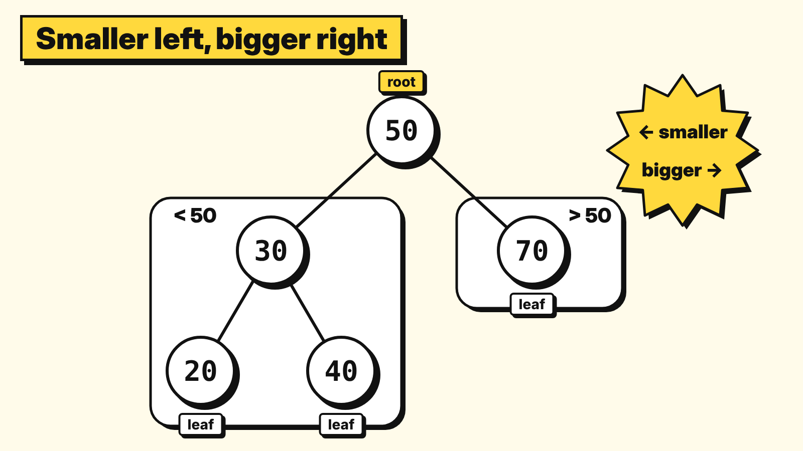
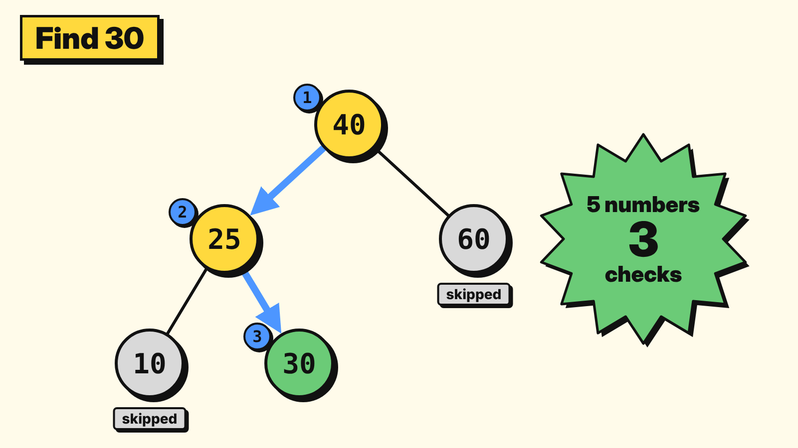

# 2.4 Trees and binary trees

> **Part:** 02 Data Structures · **Author:** Nicholas Chung · **Reviewer:** Derren Manuel Natalis
> **Version:** V2.0 (Stage 2, November 2026)

---

## Learning goals

After this section, you should be able to:

1. **Explain** what a tree is, using the words **root**, **parent**, **child** and **leaf**.
2. **Build** a binary search tree from a short list of numbers.
3. **Trace** a search in a binary search tree, both when the number is there and when it is **not**.
4. **Compare** searching a binary search tree with linear search and binary search.

---

## Prerequisite knowledge

| You need | Where to learn it |
|---|---|
| Binary search: check the middle, throw away half | Section 1.3 |
| What a data structure is | Section 2.3 |

---

## Key terms

| Term | Meaning |
|---|---|
| **Tree** | A data structure where items are linked like a family tree, drawn upside down. |
| **Node** | One item in the tree (one circle in a drawing). |
| **Root** | The one node at the very top. It has no parent. |
| **Parent** | A node with another node directly below it. |
| **Child** | A node directly below another node. |
| **Leaf** | A node with **no children**. Like a real leaf, nothing grows out of it: it is the end of a branch. |
| **Binary tree** | A tree where every node has **at most 2** children: a **left** child and a **right** child. |
| **Binary search tree (BST)** | A binary tree with one rule: **smaller goes left, bigger goes right**. |
| **Check (comparison)** | Looking at one node and comparing it with the target. We count checks to measure speed. |

---

## 2.4.1 Why does this matter?

**Binary search** is a very fast way to find a number in a sorted list: always check the middle, then throw away the other half. But it has one big condition:

- ⚠️ The numbers must be in a **sorted list**.

Now imagine new numbers keep arriving, for example new students joining a class list sorted by student ID:

- Every new ID must be squeezed into the right place in the list.
- Every item after that place has to **move along by one**.
- With thousands of students, that is a lot of moving, every single time.

A **binary search tree** fixes this:

- ✅ It keeps the "throw away half" idea from binary search.
- ✅ A new item is added by hanging it in an **empty spot**. Nothing else moves.

> 🧠 Everyday picture: you already use trees. The **folders on your computer** form a tree (a folder holds folders, which hold files), and so does a **family tree**.

---

## 2.4.2 The idea

### What is a tree?

A **tree** stores items (called **nodes**) in levels, linked from the top down. It looks like a real tree turned **upside down**: the root is at the top and the leaves are at the bottom.

*Diagram: an example tree with 5 nodes. Everything in the left box is smaller than 50, everything in the right box is bigger.*

| Node | Parent | Left child | Right child | Type |
|---|---|---|---|---|
| 50 | none | 30 | 70 | **Root** |
| 30 | 50 | 20 | 40 | Parent and child |
| 70 | 50 | none | none | **Leaf** |
| 20 | 30 | none | none | **Leaf** |
| 40 | 30 | none | none | **Leaf** |

In this tree:

- **50** is the **root**.
- **30** is the **parent** of 20 and 40.
- **20**, **40** and **70** are **leaves**: they have no children.
- 30 is a child (of 50) **and** a parent (of 20 and 40) at the same time.

> 🧠 Everyday picture: a **family tree**. A grandparent at the top, their children below, grandchildren below that.
>
> ⚠️ Where the picture stops working: in a real family, a child has **two** parents. In a computer tree, every node has **exactly one** parent, except the root, which has none.

### Binary tree

In a **binary tree**, every node has **at most 2 children**, a **left** child and a **right** child. "Binary" means "two", just like in binary search.

### Binary search tree (BST)

A **binary search tree** is a binary tree that follows one rule at **every** node:

- Everything in the **left** branch is **smaller** than the node.
- Everything in the **right** branch is **bigger** than the node.

Check it on the tree above: at 50, the left side (30, 20, 40) is all smaller and the right side (70) is bigger. At 30, 20 is smaller (left) and 40 is bigger (right). ✅

This rule is what makes searching fast. At each node, one comparison tells you which side the target **must** be on, so you can ignore the other side completely.

---

## 2.4.3 How it works, step by step

### Adding (inserting) a number

1. Start at the **root**.
2. Compare the new number with the node:
   - **Smaller:** go **left**.
   - **Bigger:** go **right**.
3. Repeat step 2 until you reach an **empty spot**.
4. Put the new number there. It becomes a new **leaf**.

> 📌 The **first** number you insert becomes the root. In this section we assume all numbers are different (no repeats).

### Searching for a number

1. Start at the **root**.
2. Check the node: is it the target?
   - **Yes:** stop, found! ✅
   - **Target is smaller:** go **left**.
   - **Target is bigger:** go **right**.
3. Repeat step 2.
4. If you need to go somewhere and the spot is **empty**, stop: the target is **not in the tree**. ❌

Count one **check** each time you compare the target with a node.

---

## 2.4.4 Worked example 1: build a tree, then find a number

### Part A: build the tree

Insert these numbers **in this order**: `40, 25, 60, 10, 30`

| Step | Insert | Comparisons | Where it goes | Checks |
|---|---|---|---|---|
| 1 | 40 | Tree is empty | Becomes the **root** | 0 |
| 2 | 25 | 25 < 40, go left: empty | **Left** child of 40 | 1 |
| 3 | 60 | 60 > 40, go right: empty | **Right** child of 40 | 1 |
| 4 | 10 | 10 < 40, go left to 25. 10 < 25, go left: empty | **Left** child of 25 | 2 |
| 5 | 30 | 30 < 40, go left to 25. 30 > 25, go right: empty | **Right** child of 25 | 2 |

*Diagram: the tree after inserting 40, 25, 60, 10, 30, and the 3 checks to find 30 (Part B below).*

| Node | Left child | Right child |
|---|---|---|
| 40 (root) | 25 | 60 |
| 25 | 10 | 30 |
| 60 | none | none |
| 10 | none | none |
| 30 | none | none |

✅ Rule check: everything left of 40 (25, 10, 30) is smaller than 40. Everything right of 40 (60) is bigger. At 25, 10 is smaller (left) and 30 is bigger (right).

### Part B: search for 30

| Check # | Node | Compare | Decision |
|---|---|---|---|
| 1 | 40 | 30 < 40 | Go **left** |
| 2 | 25 | 30 > 25 | Go **right** |
| 3 | 30 | 30 = 30 | **Found!** ✅ |

✅ Found after **3 checks**. We never looked at 60 or 10.

---

## 2.4.5 Worked example 2: the number is NOT in the tree

Same tree. Target: **50**

| Check # | Node | Compare | Decision |
|---|---|---|---|
| 1 | 40 | 50 > 40 | Go **right** |
| 2 | 60 | 50 < 60 | Go **left**, but 60 has no left child: the spot is **empty** |

❌ Not found after only **2 checks**.

Why can we be sure? If 50 were in the tree, the BST rule says it **must** be in that empty spot (right of 40, then left of 60). The spot is empty, so 50 is not anywhere in the tree.

> 📌 Compare: linear search on the same 5 numbers (`40, 25, 60, 10, 30`) needs **5 checks** to be sure 50 is missing, because it has to look at every number.

---

## 2.4.6 Common misunderstandings

| Mistake | Why it is wrong | Correct idea |
|---|---|---|
| "Searching a tree of 5 numbers takes 5 checks." | That is linear search: looking at every number. | In a BST you follow **one path** from the root down. You never visit the other side. |
| Comparing with the **root** every time, or going left because a number "feels small". | 35 is smaller than 50 but **bigger** than 30. The direction can change at every node. | At each step, compare with the node you are **at right now**. |
| "The root is the smallest (or the middle) number." | The root is simply the **first** number inserted. The smallest number is the **leftmost** node: keep going left until you can't. | Insert order decides the root and the shape of the tree. |
| "A leaf has leaves (children) under it." | The name comes from a real tree: a leaf is where a branch **ends**. | A leaf has **no children**. |
| "Leaves are only on the bottom row." | A leaf is any node with **no children**. In 2.4.4, 60 is a leaf even though 10 and 30 are lower. | Leaf = no children, wherever it is. |
| "A BST is always as fast as binary search." | If you insert numbers that are **already sorted** (10, 20, 30, 40, 50), every number goes right. The tree becomes one long line, and finding 50 takes **5 checks**, the same as linear search. | A BST is fast when it is **bushy** (balanced), not when it is a long line. |

---

## 2.4.7 Learner activity: build it, then search it 🌳

**Goal:** build a binary search tree and search it, counting checks.
**You need:** paper and a pen. Optional: a partner who reads the numbers out one at a time.

**Task:**

1. Build a BST by inserting these numbers **in this order**: `55, 30, 80, 65, 15`
   For each number, write the comparisons you make (for example "65 > 55, go right").
2. Draw the finished tree.
3. Name the **root**, the **leaves**, and the **parent of 65**.
4. Search for **65**. Count your checks.
5. Search for **40**. Count your checks. Is it in the tree? How do you know?
6. **Predict:** you build a new tree from the same numbers, but sorted: `15, 30, 55, 65, 80`. How many checks will it take to find 80? Why?

**Record:**

| Search | Nodes visited | Checks | Found? |
|---|---|---|---|
| 65 | | | |
| 40 | | | |
| 80 (sorted tree) | | | |

*(Answers are in 2.4.9.)*

---

## 2.4.8 Check your understanding

**Q1.** In the tree from 2.4.4 (built from `40, 25, 60, 10, 30`), name the root, the leaves, and the parent of 10.

**Q2.** Insert **27** into the tree from 2.4.4. Write each comparison. Where does 27 end up, and how many checks did it take?

**Q3. Find the error.** Lily says: "To find 10 in the tree from 2.4.4, you need 5 checks, because there are 5 numbers." What is wrong, and what is the right answer?

**Q4.** Is this a binary search tree? Explain.

| Node | Left child | Right child |
|---|---|---|
| 50 (root) | 60 | 70 |

**Q5.** How many children can a node in a binary tree have?
a) Exactly 2  b) 0, 1 or 2  c) Any number  d) At least 1

**Q6. True or false:** "Searching a binary search tree always needs fewer checks than linear search." Explain your answer.

---

## 2.4.9 Answers and explanations

**Activity:**

1. and 2. Building the tree:

| Insert | Comparisons | Where it goes |
|---|---|---|
| 55 | Tree is empty | **Root** |
| 30 | 30 < 55, go left: empty | Left child of 55 |
| 80 | 80 > 55, go right: empty | Right child of 55 |
| 65 | 65 > 55, go right to 80. 65 < 80, go left: empty | Left child of 80 |
| 15 | 15 < 55, go left to 30. 15 < 30, go left: empty | Left child of 30 |

| Node | Left child | Right child |
|---|---|---|
| 55 (root) | 30 | 80 |
| 30 | 15 | none |
| 80 | 65 | none |
| 15 | none | none |
| 65 | none | none |

3. Root: **55**. Leaves: **15** and **65**. Parent of 65: **80**.

4. and 5. Searches:

| Search | Nodes visited | Checks | Found? |
|---|---|---|---|
| 65 | 55 (go right), 80 (go left), 65 | **3** | ✅ Yes |
| 40 | 55 (go left), 30 (go right: empty) | **2** | ❌ No. If 40 were in the tree, it would have to be right of 30, and that spot is empty. |
| 80 (sorted tree) | 15, 30, 55, 65, 80 | **5** | ✅ Yes, but slowly |

6. With sorted input, every new number is bigger than all the others, so it always goes **right**. The tree becomes one long line (15, 30, 55, 65, 80), and you must visit every node to reach 80. That is **5 checks**, the same as linear search. **Insert order matters.**

**Q1.** Root: **40**. Leaves: **60, 10, 30**. Parent of 10: **25**.

**Q2.** 27 < 40, go left to 25. 27 > 25, go right to 30. 27 < 30, go left: empty. 27 becomes the **left child of 30**, after **3 checks**.

**Q3.** Lily is counting like **linear search**. In a BST you only follow one path: 40 (10 < 40, go left), 25 (10 < 25, go left), 10 (found). That is **3 checks**, not 5.

**Q4.** **No.** 60 is on the **left** of 50, but 60 is **bigger** than 50. The rule says bigger numbers must go right.

**Q5.** **b) 0, 1 or 2.** "At most 2" includes leaves (0 children) and nodes with only one child.

**Q6.** **False.** A BST is usually much faster, but if the numbers were inserted in sorted order, the tree is one long line and a search can need as many checks as linear search. Also, if the target is the first item in a list, linear search finds it in 1 check.

---

## 2.4.10 Summary

- A **tree** stores items (**nodes**) in levels. The top node is the **root**, nodes with no children are **leaves**, and every node except the root has exactly **one parent**.
- In a **binary tree**, each node has **at most 2** children: left and right.
- A **binary search tree** follows one rule: **smaller goes left, bigger goes right**.
- To insert or search, start at the root and go left or right at each node. You follow **one path**, so you skip most of the tree.
- A BST is fast when it is **bushy**. If numbers are inserted in sorted order, it becomes a long line and is no faster than linear search.

---

## 2.4.11 Links to the rest of the module

| This section | Connects to | How |
|---|---|---|
| 2.4 | 1.3 Searching | Searching a BST works like binary search: each check throws away one side. A BST is binary search stored as a structure. |
| 2.4 | 2.1 Arrays | Adding to a sorted array means moving items along. In a BST a new item just hangs in an empty spot. |
| 2.4 | 2.5 Graphs | A tree is a special kind of graph: nodes linked by edges, with no loops. |

---

## References

1. Foundations of CS & AI course slides (2024), *Chap 3 Software & Algorithms*, slide 3 (topic list: trees, binary trees).
2. Cormen, T. H., Leiserson, C. E., Rivest, R. L., & Stein, C. (2022). *Introduction to Algorithms* (4th ed.), Chapter 12: Binary Search Trees. MIT Press.
3. OpenDSA, *Data Structures and Algorithms*, Binary Search Trees: https://opendsa-server.cs.vt.edu/

*AI use: drafted with help from Claude (Anthropic). Content checked by Nicholas Chung; see the project log for details.*
