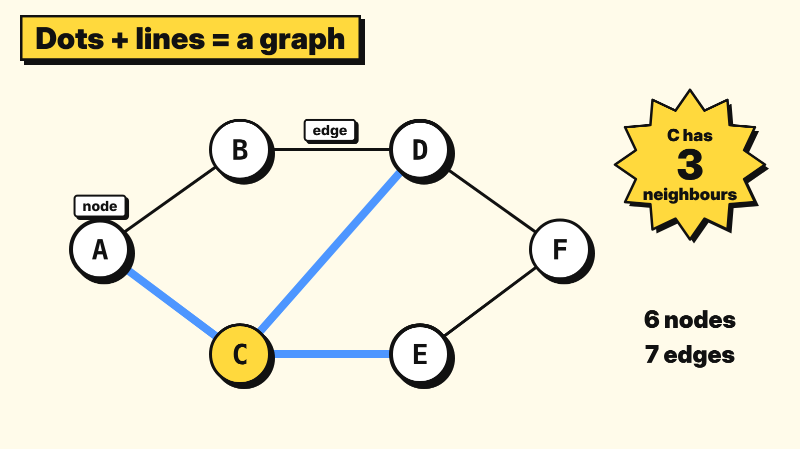
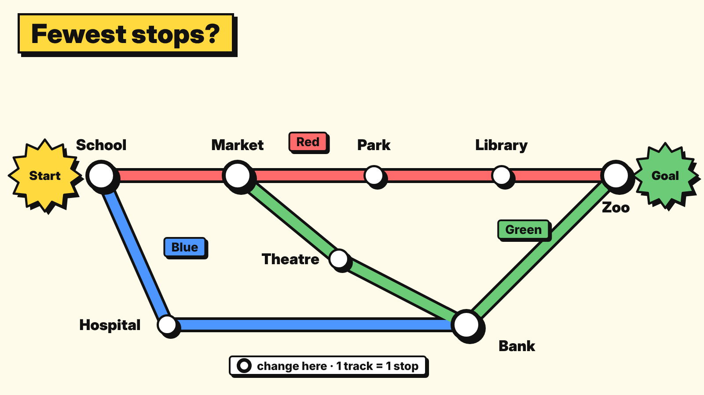

# 2.5 Graphs

> **Part:** 02 Data Structures  
> **Author:** Nicholas Chung  
> **Reviewer:** Derren Manuel Natalis  
> **Version:** V2.0 (Stage 2, November 2026)

---

## Learning goals

After this chapter, you should be able to:

1. **Explain** what a graph is, using the words **node**, **edge** and **neighbour**.
2. **Give examples** of graphs in everyday life: maps, metro lines, social networks.
3. **Trace** breadth-first search (BFS) with a queue to find the route with the **fewest stops**.
4. **Decide** when "fewest stops" is the right goal, and when it is not.

---

## Prerequisite knowledge

| You need | Where to learn it |
|---|---|
| A queue: first in, first out (FIFO) | Chapter 2.3 |
| Nodes, parent and child in a tree | Chapter 2.4 |

---

## Key terms

| Term | Meaning |
|---|---|
| **Graph** | A data structure made of **nodes** joined by **edges**. Any node can be joined to any other. |
| **Node** | One item in the graph, for example one metro station. (Also called a **vertex**.) |
| **Edge** | A link between two nodes, for example the track between two stations. |
| **Neighbour** | A node joined to another node by one edge. |
| **Path (route)** | A list of nodes you travel through, one edge at a time. |
| **Stop** | In this chapter, one edge travelled. A trip from A to B to D has **2 stops**. |
| **Cycle** | A route that comes back to where it started without using any edge twice, for example A, B, D, C, back to A. (Not the same as a cycle in an algorithm, Chapters 1.2 and 1.5.) |
| **Visited** | A node we have already reached and written down, so we never add it again. |
| **Breadth-first search (BFS)** | An algorithm that explores a graph in **rings**: all nodes 1 stop away, then all 2 stops away, and so on. |
| **Queue** | A list where items join at the back and leave from the front (FIFO). |

---

## 2.5.1 Why does this matter?

You are at a metro station and want to reach the zoo. There are three coloured lines, some stations are on two lines, and the map looks like spaghetti. Which route has the **fewest stops**?

- Your eyes can solve a small map, but a city like Beijing has hundreds of stations.
- A navigation app answers this question in a fraction of a second.
- To do that, the app stores the map as a **graph** and runs an algorithm on it.

Graphs are everywhere:

- 🚇 **Metro maps:** stations are nodes, tracks are edges.
- 🗺️ **Road maps:** towns are nodes, roads are edges.
- 👥 **Social networks:** people are nodes, "friends with" is an edge.
- 🌐 **The internet:** computers are nodes, cables and Wi-Fi links are edges.

---

## 2.5.2 The idea

### What is a graph?

A **graph** is a set of **nodes** joined by **edges**. That is all. Only the connections matter:

- Where you draw a node on the page does **not** matter.
- How long you draw an edge does **not** matter.
- What matters is **who is joined to whom**.

*Diagram: a small graph with 6 nodes and 7 edges. The blue edges join C to its 3 neighbours.*

| Edge | Joins |
|---|---|
| 1 | A and B |
| 2 | A and C |
| 3 | B and D |
| 4 | C and D |
| 5 | C and E |
| 6 | D and F |
| 7 | E and F |

In this graph, the **neighbours** of C are A, D and E.

> 🧠 Everyday picture: a **metro map**. It is not drawn to scale. Stations that are far apart can look close, and the lines are straightened out. It only shows which station connects to which, and that is exactly what a graph is.
>
> ⚠️ Where the picture stops working: a metro map has coloured lines and changes between lines. A basic graph only has nodes and edges, with no colours and no "changing" cost.

### Graphs and trees

A **tree** (Chapter 2.4) is a special kind of graph:

| | Tree | Graph |
|---|---|---|
| Top node (root)? | Yes, one root | No, there is no "top" |
| Cycles (go round and come back)? | **Never** | **Allowed**, for example A, B, D, C, back to A |
| Number of parents | Exactly one (except the root) | No such idea: a node can have any number of neighbours |

Because graphs can have **cycles**, an algorithm can walk round in circles forever unless it remembers which nodes it has already **visited**.

> 📌 In this chapter all edges are **two-way** (you can travel both directions) and every edge counts as **1 stop**. Some graphs have one-way edges or distances on edges. Those need other algorithms.

### The BFS idea: explore in rings

**Breadth-first search (BFS)** finds the route with the **fewest stops** by exploring in rings, like ripples spreading out when a stone drops into water:

1. First, every node **1 stop** from the start.
2. Then every node **2 stops** from the start.
3. Then 3 stops, and so on, until it reaches the target.

Because it never looks at a 3-stop node before all the 2-stop nodes, the **first** time it reaches the target must be by the fewest stops.

To keep the rings in order, BFS uses a **queue** (Chapter 2.3): nodes found first are explored first.

---

## 2.5.3 How it works, step by step

1. Put the **start** node in the queue. Mark it **visited**.
2. Take the node at the **front** of the queue.
3. Look at each of its **neighbours** (in alphabetical order, to keep things tidy):
   - Already **visited**? Skip it.
   - Not visited? Mark it visited, write down **where you came from**, and add it to the **back** of the queue.
   - Is it the **target**? Stop, found! ✅
4. Repeat steps 2 and 3.
5. If the queue becomes **empty** and you never reached the target, there is **no route**. ❌

**Finding the route:** start at the target and follow "came from" backwards to the start.

---

## 2.5.4 Worked example 1: fewest stops from A to F

Use the graph from 2.5.2. Start: **A**. Target: **F**.

| Step | Take from front | Neighbours | New nodes added (came from) | Queue after (front → back) | Visited |
|---|---|---|---|---|---|
| 0 | (start) | | A | A | A |
| 1 | A | B, C | B (A), C (A) | B, C | A, B, C |
| 2 | B | A, D | D (B). A is already visited | C, D | A, B, C, D |
| 3 | C | A, D, E | E (C). A and D already visited | D, E | A, B, C, D, E |
| 4 | D | B, C, F | F (D). **F is the target: stop!** ✅ | | |

**Route:** follow "came from" backwards. F came from D, D came from B, B came from A. So the route is **A → B → D → F: 3 stops**.

Rings: B and C are 1 stop away, D and E are 2 stops away, F is 3 stops away.

> 📌 A → C → E → F is also 3 stops. There can be more than one route with the fewest stops. BFS finds **one** of them.

---

## 2.5.5 Worked example 2: no route

A new graph with 5 nodes and 3 edges: A joins B, B joins C, and D joins E. Start: **A**. Target: **E**.

| Step | Take from front | Neighbours | New nodes added | Queue after | Visited |
|---|---|---|---|---|---|
| 0 | (start) | | A | A | A |
| 1 | A | B | B (A) | B | A, B |
| 2 | B | A, C | C (B) | C | A, B, C |
| 3 | C | B | none | **empty** | A, B, C |

❌ The queue is empty and E was never reached. There is **no route** from A to E: the graph is in two separate pieces (A, B, C and D, E).

> 🧠 Everyday picture: two metro lines that never share a station. You cannot get from one to the other by metro, however long you ride.

---

## 2.5.6 Common misunderstandings

| Mistake | Why it is wrong | Correct idea |
|---|---|---|
| "Fewest stops means the fastest trip." | BFS counts edges, not minutes or kilometres. Changing lines or long tracks can make a short route slow. | BFS finds the fewest **stops**. For time or distance you need other algorithms. |
| "Two nodes drawn close together must be neighbours." | Position on the page means nothing. | Two nodes are neighbours only if an **edge** joins them. |
| Forgetting to mark nodes as **visited**. | With cycles (A, B, D, C, A) you go round in circles and add the same node again and again. | Mark a node visited the moment you add it, and skip visited nodes. |
| Using a **stack** instead of a queue. | A stack (LIFO) dives deep down one route first, so the first route it finds may not have the fewest stops. | BFS needs a **queue** (FIFO) so it finishes each ring before the next. |
| "A graph is the same as a tree." | A tree has one root and no cycles. A graph can have cycles and no root. | Every tree is a graph, but not every graph is a tree. |

---

## 2.5.7 Learner activity: fewest stops on the metro 🚇

**Goal:** use BFS to find the route with the fewest stops, then decide if it is really the best route.
**You need:** paper and a pen. Optional: a partner who checks your queue at each step.

**The metro map** (8 stations, 3 lines):

*Diagram: the metro map. Big rings are stations where you can change lines.*

| Line | Stations in order |
|---|---|
| 🔴 Red | School, Market, Park, Library, Zoo |
| 🔵 Blue | School, Hospital, Bank |
| 🟢 Green | Market, Theatre, Bank, Zoo |

Trains go both ways. Each track between two stations next to each other on a line is **one edge = one stop**.

**Task:**

1. Write each station's **neighbours**. (Hint: Market has 3 neighbours, Bank has 3.)
2. Use BFS to find the route with the **fewest stops** from **School** to **Zoo**. Use a table like the one in 2.5.4. Look at neighbours in alphabetical order.
3. Write the route and count the stops.
4. **Compare:** how many stops is it to stay on the Red line all the way from School to Zoo?
5. **Decide:** each stop takes **2 minutes**, and **changing lines** takes **5 minutes**. Which route is faster: your BFS route, or staying on the Red line? What does this tell you about BFS?
6. **Predict, then check:** how many stops from **Library** to **Hospital**?

**Record:**

| Question | Your answer |
|---|---|
| BFS route School to Zoo | |
| Number of stops | |
| Red line only: stops | |
| Faster route (minutes) | |
| Library to Hospital: stops | |

*(Answers are in 2.5.9.)*

---

## 2.5.8 Check your understanding

**Q1.** In the graph from 2.5.2, how many nodes and how many edges are there? What are the neighbours of D?

**Q2.** Is the graph from 2.5.2 a tree? Explain.

**Q3. Find the error.** Tom runs BFS from A to F (2.5.4) and gets A → B → D → F. He says: "So A → C → E → F must be longer." Is he right?

**Q4.** Which structure does BFS use to decide which node to explore next?
a) A stack  b) A queue  c) A binary search tree  d) A sorted list

**Q5.** During BFS, why do we mark a node as **visited** when we add it to the queue?

**Q6. True or false:** "The route with the fewest stops is always the fastest trip." Explain your answer.

---

## 2.5.9 Answers and explanations

**Activity:**

1. Neighbours:

| Station | Neighbours |
|---|---|
| Bank | Hospital, Theatre, Zoo |
| Hospital | Bank, School |
| Library | Park, Zoo |
| Market | Park, School, Theatre |
| Park | Library, Market |
| School | Hospital, Market |
| Theatre | Bank, Market |
| Zoo | Bank, Library |

2. BFS from School to Zoo:

| Step | Take from front | New nodes added (came from) | Queue after (front → back) |
|---|---|---|---|
| 0 | (start) | School | School |
| 1 | School | Hospital (School), Market (School) | Hospital, Market |
| 2 | Hospital | Bank (Hospital). School already visited | Market, Bank |
| 3 | Market | Park (Market), Theatre (Market). School already visited | Bank, Park, Theatre |
| 4 | Bank | Zoo (Bank). **Target: stop!** ✅ Hospital already visited, Theatre already in the queue | |

3. Zoo came from Bank, Bank from Hospital, Hospital from School. Route: **School → Hospital → Bank → Zoo: 3 stops** (Blue line, then change to Green at Bank).

4. Red line only: School → Market → Park → Library → Zoo: **4 stops**.

5. BFS route: 3 stops × 2 min + 1 change × 5 min = 6 + 5 = **11 minutes**. Red line: 4 stops × 2 min + 0 changes = **8 minutes**. The **Red line is faster**, even with more stops. BFS answers exactly the question it was given (fewest stops). If you care about time, you must count time, not stops.

6. **3 stops:** Library → Zoo → Bank → Hospital. (BFS rings from Library: Park and Zoo at 1 stop; Market and Bank at 2 stops; School, Theatre and Hospital at 3 stops.)

**Q1.** **6 nodes** (A to F) and **7 edges**. Neighbours of D: **B, C, F**.

**Q2.** **No.** It has a **cycle**: A, B, D, C, back to A. A tree never has cycles. (It also has no single root.)

**Q3.** **No.** A → C → E → F is also **3 stops**. BFS stops at the first route it finds with the fewest stops, but other routes can have the same number. "Found first" does not mean the others are longer.

**Q4.** **b) A queue.** Nodes found first are explored first (FIFO), so BFS finishes all 1-stop nodes before any 2-stop node. A stack would dive down one route first.

**Q5.** So we never add the same node twice. Without it, a cycle would make BFS go round in circles, and the queue would fill up with repeats.

**Q6.** **False.** BFS counts stops, not time. In the activity, the 3-stop route takes 11 minutes because of a line change, but the 4-stop Red line route takes only 8 minutes.

---

## 2.5.10 Summary

- A **graph** is a set of **nodes** joined by **edges**. Only the connections matter, not the drawing.
- Maps, metro lines, social networks and the internet can all be stored as graphs.
- A **tree** is a special graph with one root and no cycles. Graphs can have cycles, so we mark nodes as **visited**.
- **BFS** explores in rings (1 stop away, then 2, then 3) using a **queue**, so the first time it reaches the target is by the **fewest stops**.
- Fewest stops is not always the fastest trip: choose the algorithm that matches the real question.

---

## 2.5.11 Links to the rest of the module

| This chapter | Connects to | How |
|---|---|---|
| 2.5 | 2.3 Stacks and queues | BFS keeps its "to explore next" list in a **queue** (FIFO). |
| 2.5 | 2.4 Trees and binary trees | A tree is a graph with one root and no cycles. |
| 2.5 | 1.1 Algorithms | BFS is an algorithm: finite, step-by-step, clear instructions that solve the "fewest stops" problem. |

---

## References

1. Foundations of CS & AI course slides (2024), *Chap 3 Software & Algorithms*, slide 3 (topic list: graphs) and slide 4 (sample learning materials: BFS).
2. OpenDSA, *CS3 Data Structures & Algorithms*, 14.3 Graph Traversals (breadth-first search): https://opendsa-server.cs.vt.edu/ODSA/Books/CS3/html/GraphTraversal.html

*AI use: drafted with help from Claude (Anthropic). Content checked by Nicholas Chung; see the project log for details.*
