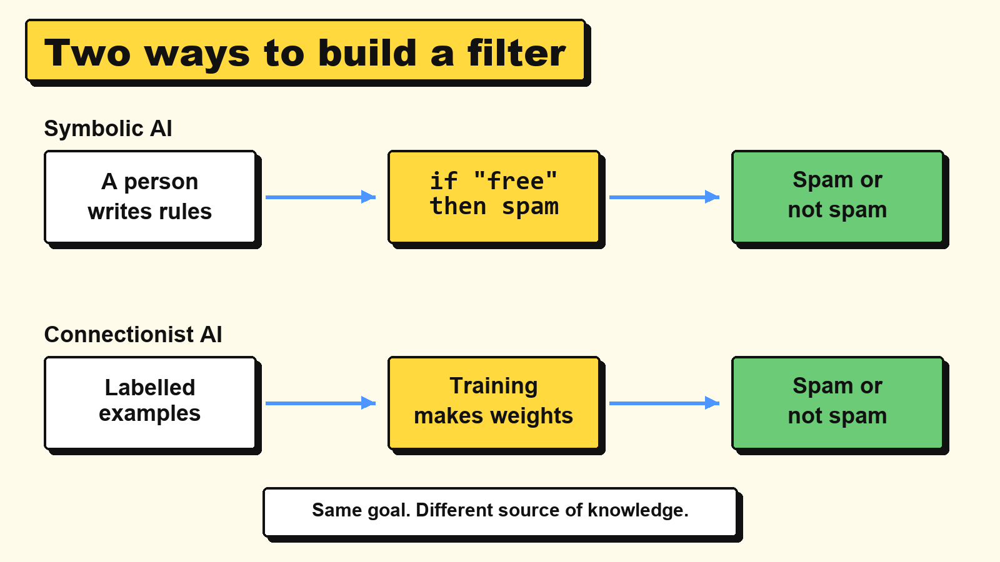

# 3.1 Connectionist vs symbolic AI

> **Part:** 03 Connectionist AI  
> **Author:** Amadeus Kenzie Solihin (first draft by Claude, see AI use at the end)  
> **Reviewer:** Antony Wijaya  
> **Version:** V2.0 (Stage 2, November 2026)

## Learning goals

After this chapter, you can:

1. **Explain** the difference between symbolic AI (rules written by people) and connectionist AI (patterns learned from examples).
2. **Trace** a small spam filter of each kind on the same messages.
3. **Compare** the two approaches and **choose** one for a real situation, giving a reason.

## Prerequisite knowledge

| You need | Where to learn it |
|---|---|
| What an algorithm is | Chapter 1.1 |
| Adding positive and negative numbers | Basic arithmetic |

## Key terms

| Term | Meaning |
|---|---|
| **Artificial intelligence (AI)** | Computer systems doing tasks that we would call intelligent if a person did them. |
| **Symbolic AI** | AI where people write the knowledge down as clear rules and facts. |
| **Connectionist AI** | AI built from many simple connected units (a neural network) that learns from examples. |
| **Rule** | An "if this, then that" statement written by a person. |
| **Training data** | The examples a system learns from. |
| **Label** | The correct answer attached to an example, such as "spam" or "not spam". |
| **Weight** | A number that says how much one input matters. Chapter 3.2 explains it fully. |
| **Model** | The result of learning: the stored numbers that a system uses to make decisions. |

## 3.1.1 Why does this matter?

Try this: write down the exact rules for telling a photo of a cat from a photo of a dog.

- "Cats have pointy ears." Some dogs do too.
- "Dogs are bigger." Not a chihuahua.
- "Look at the face shape." How would you say that in numbers?

You can tell them apart in less than a second, but you cannot explain how. A lot of what people know is like this, and that is the problem that split AI into two big approaches:

- **Symbolic AI:** write the knowledge down as rules.
- **Connectionist AI:** show the system many examples and let it find the pattern.

The course slides cover symbolic AI in Chap 4. This part of our module covers the connectionist approach.

## 3.1.2 The idea

*Diagram: in symbolic AI a person supplies the rules. In connectionist AI a person supplies examples and the rules are never written out.*

| Question | Symbolic AI | Connectionist AI |
|---|---|---|
| Where does the knowledge come from? | People write it as rules | It is learned from examples |
| What is stored? | Readable rules and facts | Numbers (weights) |
| What does it need? | An expert who can state the rules | A lot of labelled data |
| Can it explain a decision? | Yes: it can list the rules it used | Hard: the reason is spread across many numbers |
| How does it handle new cases? | Badly if no rule fits | Often well if they look like its examples |
| Typical use | Tax rules, eligibility checks, solving logic puzzles | Recognising images and speech, translating, chatbots |
| Old example | MYCIN (1970s): hundreds of hand-written medical rules | Perceptron (1958): one artificial neuron that learns |

> 🧠 Everyday picture: learning to cook. Symbolic AI follows a recipe book, step by step. Connectionist AI tastes hundreds of dishes and slowly gets a feel for what works.
>
> ⚠️ Where the picture stops working: a cook can tell you what they learned. A neural network usually cannot. It also has no taste or understanding, only numbers that it adjusts.

Neither approach is simply better. Many real systems use both: a bank might use a learned model to flag odd payments, and fixed rules to meet the law.

## 3.1.3 How it works, step by step

**Symbolic system**

1. A person studies the problem.
2. The person writes rules.
3. The computer applies the rules to each new case.
4. When it fails, a person writes more rules.

**Connectionist system**

1. People collect examples with labels.
2. A learning algorithm adjusts numbers until the system gets the examples right (Chapter 3.3).
3. The system applies those numbers to each new case.
4. When it fails, people add better examples and train again.

The two lists look similar, but look at step 4. In one, the fix is a new rule. In the other, the fix is new data.

## 3.1.4 Worked example 1: a spam filter with hand-written rules

We wrote one rule: **if a message contains "free" or "winner", call it spam.**

Here are four new messages, with the true answer in the last column.

| Message | Rule fires? | Filter says | True answer | Right? |
|---|---|---|---|---|
| `free cash prize` | Yes ("free") | Spam | Spam | ✅ |
| `free pizza in the library today` | Yes ("free") | Spam | Not spam | ❌ |
| `your homework is due now` | No | Not spam | Not spam | ✅ |
| `w1nner c4sh today` | No | Not spam | Spam | ❌ |

**Score: 2 out of 4.** Both mistakes teach us something:

- The rule is too blunt: "free" can be innocent.
- Spammers changed one letter, and the rule no longer sees the word.

To fix this we would have to write more rules by hand, and spammers would change again.

## 3.1.5 Worked example 2: a spam filter that learns from examples

Now nobody writes a rule. We give the system six labelled messages.

| Spam | Not spam |
|---|---|
| `claim free prize now` | `free pizza today` |
| `free prize winner` | `homework due today` |
| `claim your cash now` | `meeting moved to today` |

**Learning step.** For every word, count the messages it appears in:

**word score = (spam messages with the word) minus (not-spam messages with the word)**

| Word | In spam | In not spam | Score |
|---|---|---|---|
| claim | 2 | 0 | **+2** |
| prize | 2 | 0 | **+2** |
| now | 2 | 0 | **+2** |
| free | 2 | 1 | **+1** |
| winner | 1 | 0 | **+1** |
| your | 1 | 0 | **+1** |
| cash | 1 | 0 | **+1** |
| pizza | 0 | 1 | **-1** |
| homework | 0 | 1 | **-1** |
| due | 0 | 1 | **-1** |
| meeting, moved, to | 0 | 1 | **-1** each |
| today | 0 | 3 | **-3** |

**Decision step.** Add the scores of the words in a message. A word we never saw counts 0. If the total is **greater than 0**, call it spam.

| Message | Sum of the word scores | Total | Filter says | True answer | Right? |
|---|---|---|---|---|---|
| `free cash prize` | +1 +1 +2 | 4 | Spam | Spam | ✅ |
| `free pizza in the library today` | +1 -1 +0 +0 +0 -3 | -3 | Not spam | Not spam | ✅ |
| `your homework is due now` | +1 -1 +0 -1 +2 | 1 | Spam | Not spam | ❌ |
| `w1nner c4sh today` | +0 +0 -3 | -3 | Not spam | Spam | ❌ |

**Score: also 2 out of 4.** It handled "free pizza" correctly, but it made new mistakes. It only had six examples, so "now" looks suspicious.

**The difference is how we fix it.** We add three new examples and count again. No rule is written.

| New example | Label |
|---|---|
| `w1nner cl4im c4sh` | Spam |
| `w1nner fr33 c4sh` | Spam |
| `your homework marks are ready now` | Not spam |

The scores change: **w1nner** and **c4sh** become +2, **homework** becomes -2, **your** becomes 0 and **now** becomes +1.

| Message | Sum of the word scores | Total | Filter says | Right? |
|---|---|---|---|---|
| `free cash prize` | +1 +1 +2 | 4 | Spam | ✅ |
| `free pizza in the library today` | +1 -1 +0 +0 +0 -3 | -3 | Not spam | ✅ |
| `your homework is due now` | 0 -2 +0 -1 +1 | -2 | Not spam | ✅ |
| `w1nner c4sh today` | +2 +2 -3 | 1 | Spam | ✅ |

**Score: 4 out of 4** on these messages. Be careful: we used these same four messages to choose the new examples, so this is not a fair test. Chapter 3.3 explains why fair testing needs messages the system has not seen.

> 📌 Compare this with Chapter 3.2. Each word is an input, each score is a **weight**, and "greater than 0" is the same test a perceptron uses. Counting is a very simple way to get weights. Real spam filters use better statistics, and neural networks use the training method in Chapter 3.3, but the idea is the same: the numbers come from the data.

## 3.1.6 Common misunderstandings

| Mistake | Why it is wrong | Correct idea |
|---|---|---|
| "Symbolic AI is old, so it is useless." | Fixed rules are still the right tool when the rules are known and must be followed exactly, such as tax rules. | Choose by the problem, not by age. |
| "A learned system has no rules, so it cannot be wrong in a pattern." | It copies patterns from its data, including bad ones. In 3.1.5 it learned that "today" means safe. | A learned system is only as good as its examples. See Chapter 3.6. |
| "A learned system understands what spam is." | It only adds numbers. It has no idea what a prize or a pizza is. | Good results do not prove understanding. |
| "Connectionist AI needs no people." | People choose the data, write the labels, decide what success means, and check the results. | People move from writing rules to preparing data and checking results. |
| "Getting training examples right means it works." | In 3.1.5 the first score on new messages was only 2 out of 4. | Test on messages it has not seen. |

## 3.1.7 Learner activity: be the spam filter 📨

**Goal:** build both kinds of filter by hand and compare how you fix a mistake.  
**You need:** paper and a pen. Optional: a partner who reads out the messages.

**Task:**

1. **Rules.** Write one or two "if the message contains..., it is spam" rules of your own, using only the six training messages below.
2. **Learn.** Make a word score table from these messages. Count each word once per message.

| Spam | Not spam |
|---|---|
| `win cash now` | `lunch today` |
| `cheap phone deal now` | `class today at nine` |
| `win a phone today` | `call me now` |

3. **Test.** Use your table on these four messages. Add the word scores. A total greater than 0 means spam. Unknown words count 0.

| Message | True answer |
|---|---|
| `win a free phone` | Spam |
| `lunch at nine today` | Not spam |
| `call me about the phone today` | Not spam |
| `cheap lunch now` | Not spam |

4. **Fix.** One message should be wrong. Add this new example to your not-spam list: `cheap lunch at canteen now`. Update the scores and test that message again.
5. **Compare.** Test your own rules from step 1 on the same four messages. How would you fix any mistake your rules make?

**Record:**

| Message | Total from word scores | Filter says | Right? | Your rules say |
|---|---|---|---|---|
| `win a free phone` | | | | |
| `lunch at nine today` | | | | |
| `call me about the phone today` | | | | |
| `cheap lunch now` | | | | |
| `cheap lunch now` (after the fix) | | | | |

*(Answers are in 3.1.9.)*

## 3.1.8 Check your understanding

**Q1.** A university has exact written rules for who can graduate. Would you use symbolic or connectionist AI to check them? Why?

**Q2.** A hospital wants to spot one kind of tumour in scans. Doctors can do it but cannot fully say how, and there are thousands of labelled scans. Which approach fits better? Why?

**Q3.** Using the first word score table in 3.1.5, what does the filter say about `claim your pizza today`?

**Q4. Find the error.** Ravi says: "My filter got every training message right, so it will work on anything." What is wrong with this?

**Q5. True or false:** "In connectionist AI, the fix for a mistake is usually to write a new rule." Explain.

## 3.1.9 Answers and explanations

**Activity:**

Word scores from step 2:

| Score | Words |
|---|---|
| +2 | win, phone |
| +1 | cash, cheap, deal, a, now (2 spam, 1 not spam) |
| -1 | today (1 spam, 2 not spam), lunch, class, at, nine, call, me |

Step 3:

| Message | Sum | Total | Filter says | Right? |
|---|---|---|---|---|
| `win a free phone` | +2 +1 +0 +2 | 5 | Spam | ✅ |
| `lunch at nine today` | -1 -1 -1 -1 | -4 | Not spam | ✅ |
| `call me about the phone today` | -1 -1 +0 +0 +2 -1 | -1 | Not spam | ✅ |
| `cheap lunch now` | +1 -1 +1 | 1 | Spam | ❌ |

Step 4: the new example changes **cheap** to 0 (1 spam, 1 not spam), **lunch** to -2 and **now** to 0 (2 spam, 2 not spam). Now `cheap lunch now` = 0 - 2 + 0 = **-2: not spam** ✅. You fixed it without writing a rule.

Step 5 depends on your rules. Expected result: a rule such as "contains cheap" also calls `cheap lunch now` spam, and you can only fix it by writing another rule, such as "unless it contains lunch". Each exception makes the rule list longer.

**Q1.** **Symbolic.** The rules are already known and exact, and the university must be able to explain each decision. Learning them from examples would only risk new mistakes.

**Q2.** **Connectionist.** The experts cannot state the rules, but labelled examples exist. A doctor should still check the results (Chapter 3.6).

**Q3.** claim +2, your +1, pizza -1, today -3. Total = **-1**, so **not spam**. A word like "today" can outweigh a suspicious word, which is a weakness of learning from so few examples.

**Q4.** The training messages are the ones it learned from, so getting them right proves little. It must be tested on messages it has not seen.

**Q5.** **False.** The usual fix is to add better examples and train again. Writing a new rule is the symbolic fix.

## 3.1.10 Summary

- **Symbolic AI** stores knowledge as rules written by people. It is clear and easy to explain, but it breaks when no rule fits.
- **Connectionist AI** learns numbers (weights) from labelled examples. It handles things people cannot put into rules, but it needs data and is hard to explain.
- In symbolic AI you fix a mistake by writing rules. In connectionist AI you fix it with better data and more training.
- Neither is always better, and many real systems combine them.

## 3.1.11 Links to the rest of the module

| This chapter | Connects to | How |
|---|---|---|
| 3.1 | 1.1 What is an algorithm? | Rules are algorithms written by people. Learning is an algorithm that produces the numbers. |
| 3.1 | 3.2 The perceptron | Word scores work like weights, and "greater than 0" is the perceptron's test. |
| 3.1 | 3.3 How networks learn | Replaces our simple counting with a method that corrects weights after each mistake. |
| 3.1 | 3.6 Ethics and challenges | A system that learns from data also learns the problems in that data. |

## References

1. Foundations of CS & AI course slides (2024), *Chap 4 Symbolic AI* and *Chap 5 Connectionist AI & Big Data Overview*, slide 2 (topic list).
2. Russell, S., & Norvig, P. (2021). *Artificial Intelligence: A Modern Approach* (4th ed.). Pearson. Chapter 19: Learning from Examples; Chapter 21: Deep Learning.
3. Shortliffe, E. H. (1976). *Computer-Based Medical Consultations: MYCIN.* Elsevier.
4. Rosenblatt, F. (1958). The perceptron: A probabilistic model for information storage and organization in the brain. *Psychological Review, 65*(6), 386 to 408.
5. Graham, P. (2002). *A Plan for Spam.* https://paulgraham.com/spam.html (spam filtering that learns from word counts).

*AI use: first draft by Claude (Anthropic) at Kenzie's request. The worked examples and answers were also checked with a small program. See the project log for what was checked and changed.*
