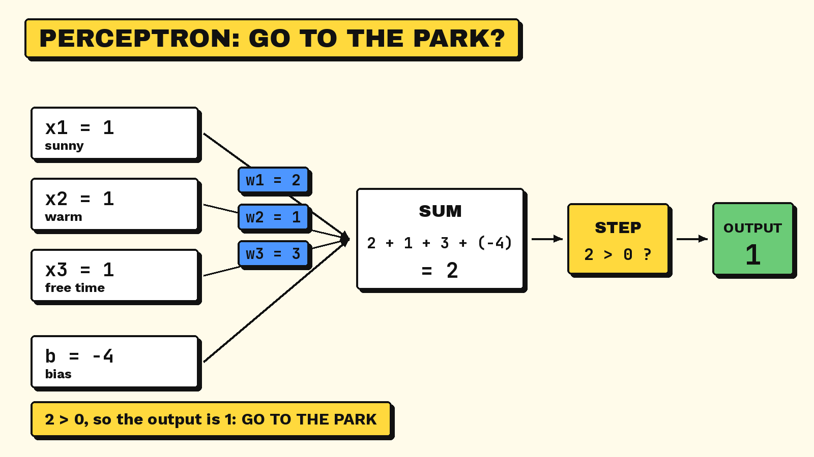

# 3.2 The Perceptron

> **Part:** 03 Connectionist AI · **Author:** Cristo Berlino · **Reviewer:** Amadeus Kenzie Solihin

## 1. Learning goals

After studying this section, you should be able to:

1. **Explain** what a perceptron is and why it is called an artificial neuron.
2. **Identify** the parts of a perceptron: inputs, weights, bias, weighted sum, and activation function.
3. **Compute** the output of a perceptron by hand for a given set of inputs.
4. **Describe** what a weight and a bias each do to the decision.
5. **Recognise** one task that a single perceptron cannot do.

## 2. Prerequisite knowledge

You need to be able to multiply two small numbers and add a list of numbers, including negative ones. You do not need any programming, algebra, or statistics.

## 3. Key terms

| Term | Meaning |
|---|---|
| **Neuron** | A brain cell. It collects signals from other cells and fires only when the total signal is strong enough. |
| **Perceptron** | A simple artificial neuron. It takes several numbers in and gives one answer out: 1 or 0. |
| **Input** | One number that describes the thing being judged. Written x1, x2, x3. |
| **Weight** | A number that says how much one input matters. Written w1, w2, w3. |
| **Bias** | An extra number added to the total. It does not depend on the inputs. |
| **Weighted sum** | Every input multiplied by its weight, all added together, plus the bias. |
| **Activation (step) function** | The rule that turns the weighted sum into the answer. The step function gives 1 or 0. |
| **Output** | The final answer of the perceptron. Here it is always 1 or 0. |
| **Threshold** | The value the weighted sum must pass before the output becomes 1. In this section the threshold is 0. |

## 4. The idea

A **perceptron** is a tiny decision maker. You give it a few facts as numbers, and it gives you one answer: yes (1) or no (0).

It copies a simple picture of a **neuron**. A brain cell collects signals from many other cells. If the signals add up to enough, it fires. If not, it stays quiet. A perceptron does the same thing with arithmetic: it adds up its inputs and fires if the total is big enough.

Here is the everyday version. Imagine you are deciding whether to go to the park. Having free time matters a lot. Sunshine matters a fair amount. Warm weather matters a little. You give each fact some points, add the points up, and go only if the total is high enough. A perceptron is that idea written as a formula.

The important part is that the facts are not equally important. The perceptron stores that importance as **weights**.

## 5. How it works

A perceptron works in two steps.

**Step 1. Add everything up.**
Multiply each input by its own weight. Add all those results together. Then add the bias.

**Step 2. Apply the step function.**
If the total is greater than 0, the output is 1. Otherwise the output is 0.

Written as a formula:

```text
output = 1 if (w1·x1 + w2·x2 + ... + b) > 0, else 0
```

Three things are worth knowing about the numbers:

- A **big weight** means that input has a strong effect on the answer.
- A **negative weight** pushes the answer towards 0, so that input argues against firing.
- The **bias** sets how easily the perceptron fires. A very negative bias means the inputs must be strong before the output becomes 1.

Note the word **greater**. If the total is exactly 0, it is not greater than 0, so the output is 0. The threshold in this section is 0.

## 6. Worked example: "Should I go outside?"

A perceptron decides whether to go outside. It has three inputs. Each one is 1 for yes and 0 for no.

| Input | Question | Weight |
|---|---|---|
| x1 | Is it sunny? | w1 = 2 |
| x2 | Is it warm? | w2 = 1 |
| x3 | Do I have free time? | w3 = 3 |

The bias is **b = -4**.

Free time has the biggest weight, so it matters most. Warm weather has the smallest weight, so it matters least.

### Case A: sunny, warm, and free time

Inputs: x1 = 1, x2 = 1, x3 = 1.

| Step | Calculation | Result |
|---|---|---|
| 1 | w1 · x1 = 2 × 1 | 2 |
| 2 | w2 · x2 = 1 × 1 | 1 |
| 3 | w3 · x3 = 3 × 1 | 3 |
| 4 | Add the three results: 2 + 1 + 3 | 6 |
| 5 | Add the bias: 6 + (-4) | 2 |
| 6 | Is 2 greater than 0? Yes | **output = 1** |

**Answer: go outside.**

### Case B: sunny and warm, but no free time

Inputs: x1 = 1, x2 = 1, x3 = 0.

| Step | Calculation | Result |
|---|---|---|
| 1 | w1 · x1 = 2 × 1 | 2 |
| 2 | w2 · x2 = 1 × 1 | 1 |
| 3 | w3 · x3 = 3 × 0 | 0 |
| 4 | Add the three results: 2 + 1 + 0 | 3 |
| 5 | Add the bias: 3 + (-4) | -1 |
| 6 | Is -1 greater than 0? No | **output = 0** |

**Answer: stay inside.**

Compare the two cases. The weather did not change. Only the free time changed, and the answer flipped. That is what a large weight does.

## 7. Diagram of a perceptron

The numbers below are the ones from Case A.



*Diagram: Case A as a picture ("go to the park" is the same question as "should I go outside?"). The text version below shows the same numbers.*

```text
  INPUTS            WEIGHTS

  x1 = 1  (sunny)  ───── w1 = 2 ─────┐
                                     │
  x2 = 1  (warm)   ───── w2 = 1 ─────┤      ┌───────────┐      ┌──────────┐
                                     ├─────►│    SUM    │─────►│   STEP   │────► OUTPUT = 1
  x3 = 1  (time)   ───── w3 = 3 ─────┤      │  2+1+3-4  │      │  > 0 ?   │
                                     │      │    = 2    │      └──────────┘
  bias             ───── b = -4 ─────┘      └───────────┘
```

Read it left to right. Each input meets its weight and they are multiplied. All the results and the bias meet in the sum box. The step box checks whether the sum is greater than 0 and gives the output.

## 8. Link to the rest of the module

The inputs and the weights are just lists of numbers. In a real program they are stored as **arrays**, the structure covered in section 2.1. Input x1 sits in the first slot of one array, and its weight w1 sits in the first slot of another.

In this section the weights were given to us. In practice a perceptron starts with poor weights and improves them. That is what **learning** means for a perceptron: changing the weights until the answers are right. Section 3.3 shows how.

## 9. Short history and limits

The perceptron was described by **Frank Rosenblatt in 1958**, while he was working at the Cornell Aeronautical Laboratory. He built it as a model of how a brain might store and organise information.

One perceptron has a limit. It cannot learn **XOR**, the rule "one input or the other, but not both", because no single straight cut through the data separates the yes cases from the no cases. The answer is to connect several perceptrons together, which is where neural networks begin.

## 10. Learner activity

Use the same perceptron from section 6: w1 = 2, w2 = 1, w3 = 3, and b = -4. Show every multiplication.

1. It is sunny, it is not warm, and you have free time. So x1 = 1, x2 = 0, x3 = 1. What is the output?
2. It is not sunny, it is warm, and you have free time. So x1 = 0, x2 = 1, x3 = 1. What is the output? Look at the final total carefully.
3. Someone changes w3 from 3 to 1 and leaves everything else alone. What is the output now for a day that is sunny, warm, and free (x1 = 1, x2 = 1, x3 = 1)? What does this tell you about weights?

## 11. Answers and explanations

**Question 1. Output = 1.**

| Step | Calculation | Result |
|---|---|---|
| 1 | 2 × 1 | 2 |
| 2 | 1 × 0 | 0 |
| 3 | 3 × 1 | 3 |
| 4 | 2 + 0 + 3 | 5 |
| 5 | 5 + (-4) | 1 |
| 6 | Is 1 greater than 0? Yes | output = 1 |

Warm weather was missing, but it has the smallest weight, so losing it did not change the decision.

**Question 2. Output = 0.**

| Step | Calculation | Result |
|---|---|---|
| 1 | 2 × 0 | 0 |
| 2 | 1 × 1 | 1 |
| 3 | 3 × 1 | 3 |
| 4 | 0 + 1 + 3 | 4 |
| 5 | 4 + (-4) | 0 |
| 6 | Is 0 greater than 0? No | output = 0 |

This is the case to watch. The total lands exactly on the threshold. Zero is not greater than zero, so the output is 0. A different rule, such as "1 if the total is 0 or more", would have given 1 here. The rule has to be stated clearly.

**Question 3. Output = 0.**

| Step | Calculation | Result |
|---|---|---|
| 1 | 2 × 1 | 2 |
| 2 | 1 × 1 | 1 |
| 3 | 1 × 1 (w3 is now 1) | 1 |
| 4 | 2 + 1 + 1 | 4 |
| 5 | 4 + (-4) | 0 |
| 6 | Is 0 greater than 0? No | output = 0 |

The day is perfect, but the perceptron says stay inside. Lowering the weight on free time told the perceptron that free time barely matters, so there is no longer enough total to pass the threshold. Changing one weight changes the decision.

## 12. Common misunderstandings

- **"A perceptron is a real brain cell."** It is not. It is a simple model built from multiplication and addition, inspired by a brain cell.
- **"A person always chooses the weights."** Only in examples like this one. A real perceptron finds its own weights by learning from examples. See section 3.3.
- **"The bias is not needed."** Without a bias the perceptron fires far too easily. In section 6 the bias of -4 is the only reason a warm sunny day with no free time gives 0.
- **"A perceptron gives a percentage or a confidence."** With a step function it gives only 1 or 0. There is no "maybe".

## 13. Check your understanding

1. What does a weight tell you about an input?
2. What does the bias do?
3. The perceptron from section 6 gets x1 = 0, x2 = 0, x3 = 1. What is the output?
4. The weighted sum plus the bias comes to exactly 0. What is the output, and why?
5. What two values can the step function give?
6. Who described the perceptron, and in which year?

### Answers

1. It tells you **how much that input matters**. A bigger weight has a stronger effect on the answer.
2. It sets **how easily the perceptron fires**. A very negative bias makes the perceptron harder to convince.
3. **0.** The calculation is (2 × 0) + (1 × 0) + (3 × 1) = 3, then 3 + (-4) = -1. Since -1 is not greater than 0, the output is 0. Free time alone is not enough.
4. **0.** The rule is "greater than 0", and 0 is not greater than 0.
5. **1 and 0.** Nothing in between.
6. **Frank Rosenblatt**, in **1958**.

## 14. Summary

- A **perceptron** is the simplest artificial neuron. It turns a few numbers into one answer, 1 or 0.
- It works in two steps: multiply each input by its weight and add everything including the bias, then apply the step function.
- The formula is `output = 1 if (w1·x1 + w2·x2 + ... + b) > 0, else 0`.
- **Weights** say how much each input matters, and the **bias** says how easily the perceptron fires.
- One perceptron cannot learn **XOR**, so real systems connect many perceptrons together.

## 15. References

1. Rosenblatt, F. (1958). *The Perceptron: A Probabilistic Model for Information Storage and Organization in the Brain.* Psychological Review, 65(6), 386 to 408. Full text PDF: https://homepages.math.uic.edu/~lreyzin/papers/rosenblatt58.pdf
2. scikit-learn developers. *sklearn.linear_model.Perceptron* (documentation for the perceptron as used in real software): https://scikit-learn.org/stable/modules/generated/sklearn.linear_model.Perceptron.html
3. Bevan, A. *Practical Machine Learning: Introductory Neural Networks* (Queen Mary University of London lecture notes, covers perceptrons, weights, and activation functions): https://pprc.qmul.ac.uk/~bevan/teaching/PML/Introductory_NNs.pdf
4. *Perceptron* (background on the history and the XOR limit): https://en.wikipedia.org/wiki/Perceptron
