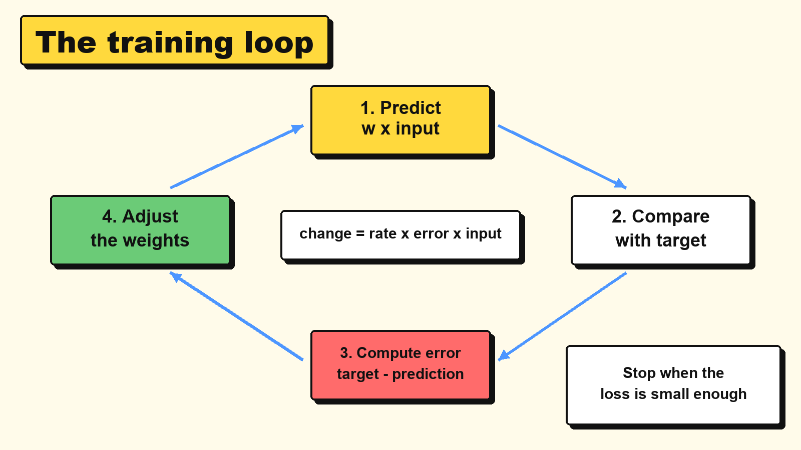

# 3.3 How networks learn

> **Part:** 03 Connectionist AI  
> **Author:** Amadeus Kenzie Solihin (first draft by Claude, see AI use at the end)  
> **Reviewer:** Antony Wijaya  
> **Version:** V2.0 (Stage 2, November 2026)

## Learning goals

After this chapter, you can:

1. **Explain** what training data, error and loss are.
2. **Compute** how one weight changes after one mistake.
3. **Trace** a perceptron learning a simple rule, step by step.
4. **Tell apart** training and inference, and **explain** why a model must be tested on new data.

## Prerequisite knowledge

| You need | Where to learn it |
|---|---|
| Inputs, weights, bias and the step function | Chapter 3.2 |
| Multiplying decimals, such as 0.1 × 6 | Basic arithmetic |

## Key terms

| Term | Meaning |
|---|---|
| **Training** | Adjusting a model's weights using examples. |
| **Training data** | The examples used for training, each with its correct answer. |
| **Target** | The correct answer for one example. |
| **Prediction** | The answer the model gives. |
| **Error** | Target minus prediction, for one example. |
| **Loss** | One number that sums up how wrong the model is. Lower is better. Here: square each error, then add them up. |
| **Learning rate** | How big each correction is. |
| **Round (epoch)** | One pass through all the training examples. |
| **Inference** | Using a finished model on new data, without changing its weights. |
| **Test data** | Examples kept aside and not used in training, to check the model fairly. |
| **Overfitting** | Doing very well on training data but badly on new data. |
| **Hidden layer** | A layer of neurons between the inputs and the output. Chapter 3.4 explains it fully. |
| **Gradient descent** | Moving every weight a small step in the direction that lowers the loss. |

## 3.3.1 Why does this matter?

In Chapter 3.2 we were **given** the weights: sunny 2, warm 1, free time 3. Someone had to pick them.

Now imagine a network with millions of weights. Nobody can pick those by hand. Yet this is the whole promise of connectionist AI: the system finds its own numbers from examples.

So how can a computer "learn"? The answer is less magical than it sounds:

> Make a guess, measure how wrong it was, nudge the weights so it would be a little less wrong, and repeat.

## 3.3.2 The idea



*Diagram: the training loop. Each trip round the loop makes the weights a little better.*

Three questions drive every correction:

| Question | How we answer it |
|---|---|
| Was the answer wrong? | Compute **error = target - prediction**. |
| Which way should the weight move? | The **sign** of the error. Prediction too low: positive error, so increase. Too high: negative error, so decrease. |
| How far should it move? | The size of the error, the size of the input and the **learning rate**. |

> 🧠 Everyday picture: adjusting a shower tap. Too cold? Turn it towards hot. Too hot? Turn it back. Small turns get you there safely. A huge turn takes you straight from freezing to burning.
>
> ⚠️ Where the picture stops working: a shower has one tap. A real network has millions of "taps", and a computer works out the direction for each of them.

## 3.3.3 How it works, step by step

For a neuron whose correct answer (target) we know, training follows this algorithm. The steps match the diagram. Bigger networks need one more idea, explained in 3.3.6.

**Before the loop:** start with some weights.

1. **Predict:** run one training example through the model.
2. **Compare:** put the prediction next to the target.
3. **Compute the error:** error = target - prediction.
4. **Adjust** each weight:

```text
change = learning rate × error × input
new weight = old weight + change
```

   Update the bias too, in the same way, using 1 as its input: `change = learning rate × error`.

5. **Repeat** steps 1 to 4 for the next example. One pass through all the examples is one **round**.
6. **Stop** when the mistakes or the loss are small enough, or after a set number of rounds.

Why multiply by the input? If an input is 0, its weight played no part in the answer, so it should not change. The formula gives a change of 0 automatically.

## 3.3.4 Worked example 1: adjust one weight

A neuron predicts a quiz score from hours of study. To keep it simple, it has one weight, no bias and **no step function**, so it can output any number:

```text
prediction = w × hours
```

Training data:

| Hours (input) | Quiz score (target) |
|---|---|
| 2 | 8 |
| 3 | 12 |

### Part A: try weights by hand and measure the loss

To get the loss, square each error, then add them. Squaring makes every error positive, so errors cannot cancel out, and it punishes big errors more.

| w | Predictions | Errors | Loss |
|---|---|---|---|
| 1 | 2, 3 | 6, 9 | 36 + 81 = **117** |
| 2 | 4, 6 | 4, 6 | 16 + 36 = **52** |
| 3 | 6, 9 | 2, 3 | 4 + 9 = **13** |
| 4 | 8, 12 | 0, 0 | 0 + 0 = **0** ✅ |
| 5 | 10, 15 | -2, -3 | 4 + 9 = **13** |

The loss goes down, reaches 0 at w = 4, then rises. If you plotted these losses against w, you would get a U-shaped curve with its lowest point at w = 4. **Training is the search for that lowest point.** With one weight we could try every value. With millions, we need the update rule.

### Part B: let the update rule find it (learning rate 0.1)

Start at w = 1.

| Step | Input | Target | Prediction | Error | Change (0.1 × error × input) | New w |
|---|---|---|---|---|---|---|
| 1 | 2 | 8 | 1 × 2 = 2 | 6 | 0.1 × 6 × 2 = 1.2 | 2.2 |
| 2 | 3 | 12 | 2.2 × 3 = 6.6 | 5.4 | 0.1 × 5.4 × 3 = 1.62 | 3.82 |
| 3 | 2 | 8 | 3.82 × 2 = 7.64 | 0.36 | 0.1 × 0.36 × 2 = 0.072 | 3.892 |
| 4 | 3 | 12 | 3.892 × 3 = 11.676 | 0.324 | 0.1 × 0.324 × 3 = 0.0972 | 3.9892 |

✅ After only 2 rounds, w is about 3.99, very close to 4. Nobody told the neuron the answer. Notice the changes also shrink as the error shrinks.

### Part C: what if the learning rate is too big? (0.5)

| Step | Input | Target | Prediction | Error | Change (0.5 × error × input) | New w |
|---|---|---|---|---|---|---|
| 1 | 2 | 8 | 2 | 6 | 6 | 7 |
| 2 | 3 | 12 | 21 | -9 | -13.5 | -6.5 |
| 3 | 2 | 8 | -13 | 21 | 21 | 14.5 |
| 4 | 3 | 12 | 43.5 | -31.5 | -47.25 | -32.75 |

❌ The weight jumps past the answer further and further, and it never settles. This is the shower tap turned too hard.

## 3.3.5 Worked example 2: a perceptron learns a rule

Now we use the perceptron from Chapter 3.2, with its step function: the output is 1 if the total is greater than 0, otherwise 0.

**The rule to learn:** an alarm rings if the window is open **or** the door is open (or both). This is called **OR**.

| x1 (window) | x2 (door) | Target |
|---|---|---|
| 0 | 0 | 0 |
| 0 | 1 | 1 |
| 1 | 0 | 1 |
| 1 | 1 | 1 |

**Start:** w1 = 0, w2 = 0, b = 0. **Learning rate:** 1. So each change is just error × input (error for the bias). Rows in bold are mistakes.

| Round | x1, x2 | Target | Total (w1·x1 + w2·x2 + b) | Output | Error | w1, w2, b after |
|---|---|---|---|---|---|---|
| 1 | 0, 0 | 0 | 0 | 0 | 0 | 0, 0, 0 |
| **1** | **0, 1** | **1** | **0** | **0** | **1** | **0, 1, 1** |
| 1 | 1, 0 | 1 | 1 | 1 | 0 | 0, 1, 1 |
| 1 | 1, 1 | 1 | 2 | 1 | 0 | 0, 1, 1 |
| **2** | **0, 0** | **0** | **1** | **1** | **-1** | **0, 1, 0** |
| 2 | 0, 1 | 1 | 1 | 1 | 0 | 0, 1, 0 |
| **2** | **1, 0** | **1** | **0** | **0** | **1** | **1, 1, 1** |
| 2 | 1, 1 | 1 | 3 | 1 | 0 | 1, 1, 1 |
| **3** | **0, 0** | **0** | **1** | **1** | **-1** | **1, 1, 0** |
| 3 | 0, 1 | 1 | 1 | 1 | 0 | 1, 1, 0 |
| 3 | 1, 0 | 1 | 1 | 1 | 0 | 1, 1, 0 |
| 3 | 1, 1 | 1 | 2 | 1 | 0 | 1, 1, 0 |
| 4 | 0, 0 | 0 | 0 | 0 | 0 | 1, 1, 0 |
| 4 | 0, 1 | 1 | 1 | 1 | 0 | 1, 1, 0 |
| 4 | 1, 0 | 1 | 1 | 1 | 0 | 1, 1, 0 |
| 4 | 1, 1 | 1 | 2 | 1 | 0 | 1, 1, 0 |

✅ Round 4 has **no mistakes**, so training stops. The perceptron found **w1 = 1, w2 = 1, b = 0** by itself. Those weights make sense: either input alone pushes the total above 0.

> 📌 Remember the limit from Chapter 3.2: one perceptron cannot learn **XOR**. If you run this same method on XOR, it keeps making mistakes forever, because no set of weights works. Chapter 3.4 shows how more layers solve this.

## 3.3.6 Bigger networks, and using a model

### From one neuron to many: backpropagation

Our rule uses "target minus output" at the neuron that gives the answer. But in a network with hidden layers (Chapter 3.4), the neurons in the middle have no target of their own. How should they change?

**Backpropagation** (popularised by Rumelhart, Hinton and Williams in 1986) answers this. It works backwards from the output and calculates how much each weight added to the loss. Then **gradient descent** moves every weight a small step in the direction that lowers the loss, the same idea as walking down to the lowest point of the U-shaped curve in 3.3.4. You do not need the maths in this module. Our step function jumps straight from 0 to 1. Real networks use a smooth activation function in its place, whose output changes gradually, because backpropagation needs small changes in a weight to cause small changes in the output.

### Training vs inference

| | Training | Inference |
|---|---|---|
| When? | Before the model is used (and when it is updated) | Every time the model is used |
| Do the weights change? | **Yes** | **No** |
| Cost | Slow, needs a lot of data and computing power | Usually fast |
| Example (made up, to show the idea) | A company trains a face recognition model for weeks | Your phone recognises your face in under a second |

### Test data and overfitting

Imagine a student who memorises the answers to last year's exam. They score 100% on that paper, then fail the real exam. They learned the answers, not the subject. A model can do the same. This is **overfitting**.

So teams split their data **before** training:

1. **Training data:** the model learns from this.
2. **Test data:** kept hidden during training, and used at the end for a fair score.

These two models are made up, to show the idea:

| Model | Score on training data | Score on test data | Verdict |
|---|---|---|---|
| A | 100% | 62% | Overfitting: it memorised the examples |
| B | 90% | 88% | Better: it found a pattern that also works on new data |

## 3.3.7 Common misunderstandings

| Mistake | Why it is wrong | Correct idea |
|---|---|---|
| "The model learns all the time while you use it." | In inference, the weights stay fixed. | It only learns during training, unless a team trains it again. |
| "A bigger learning rate always learns faster." | In 3.3.4 Part C, 0.5 made the weight jump further and further from the answer. | Too big jumps past the answer. Too small is slow. |
| "Error and loss are the same thing." | Error is for one example. Loss sums up how wrong the model is. | Training tries to lower the loss. |
| "100% on training data means a great model." | Model A in 3.3.6 scored 100% and was still poor. | Trust the score on test data. |
| "Training changes the inputs." | The inputs are facts from the data. | Training changes only the **weights and bias**. |
| "A mistake means every weight changes." | If an input is 0, its change is 0. In 3.3.5, round 2, the error for inputs 0, 0 changed only the bias. | change = learning rate × error × input. |

## 3.3.8 Learner activity: be the training algorithm 🔧

**Goal:** adjust weights by hand and see the loss fall.  
**You need:** paper, a pen and a calculator (optional).

### Part A: bubble tea price

A shop charges a fixed price per cup. Your neuron: `prediction = w × cups`.

Training data: **2 cups cost 10** and **4 cups cost 20**.

1. **Predict:** which value of w will give the lowest loss?
2. Fill in the table.

| w | Predictions | Errors | Loss |
|---|---|---|---|
| 3 | | | |
| 4 | | | |
| 5 | | | |
| 6 | | | |

3. Start at w = 3. Apply the update rule **once**, with the example "2 cups cost 10" and a learning rate of 0.1. What is the new w? Did it move the right way?

### Part B: teach a perceptron AND

**The rule:** a door opens only if you have a ticket **and** an ID.

Start: **w1 = 1, w2 = 2, b = -1**. Learning rate: 1. Remember, the output is 1 only if the total is **greater than** 0.

Work through the four examples in the order shown, and repeat until one whole round has no mistakes.

| Round | x1 (ticket), x2 (ID) | Target | Total | Output | Error | w1, w2, b after |
|---|---|---|---|---|---|---|
| 1 | 0, 0 | 0 | | | | |
| 1 | 0, 1 | 0 | | | | |
| 1 | 1, 0 | 0 | | | | |
| 1 | 1, 1 | 1 | | | | |

**Record:** how many rounds did it take? What were the final weights? Why does w1 end up bigger than w2 even though the two inputs are equally important in the rule?

### Part C: choose a model

| Model | Training score | Test score |
|---|---|---|
| X | 99% | 70% |
| Y | 85% | 83% |

Which would you use on real users? Explain in one sentence.

*(Answers are in 3.3.10.)*

## 3.3.9 Check your understanding

**Q1.** A neuron has w = 2. For one example the input is 3 and the target is 9. With a learning rate of 0.1, what is the new weight? Show your steps.

**Q2.** The prediction is **higher** than the target, and the input is positive. Will the weight go up or down? Why?

**Q3.** A perceptron has w1 = 1, w2 = 1, b = 0 and a learning rate of 1. The example is x1 = 0, x2 = 1, with target 0. Find the output, the error and the new weights.

**Q4.** Your phone unlocks with your face. Is that training or inference? How do you know?

**Q5. Find the error.** Mei says: "My model scored 100% on the training data, so I don't need test data." What would you tell Mei?

**Q6. True or false:** "With enough rounds, the perceptron learning rule will learn XOR." Explain.

## 3.3.10 Answers and explanations

**Part A.**

| w | Predictions | Errors | Loss |
|---|---|---|---|
| 3 | 6, 12 | 4, 8 | 16 + 64 = **80** |
| 4 | 8, 16 | 2, 4 | 4 + 16 = **20** |
| 5 | 10, 20 | 0, 0 | **0** ✅ |
| 6 | 12, 24 | -2, -4 | 4 + 16 = **20** |

Step 3: the prediction is 3 × 2 = 6, the error is 10 - 6 = 4, the change is 0.1 × 4 × 2 = 0.8, so the **new w = 3.8**. Yes, it moved the right way, towards 5.

**Part B.**

| Round | x1, x2 | Target | Total | Output | Error | w1, w2, b after |
|---|---|---|---|---|---|---|
| 1 | 0, 0 | 0 | -1 | 0 | 0 | 1, 2, -1 |
| 1 | 0, 1 | 0 | 1 | 1 | -1 | 1, 1, -2 |
| 1 | 1, 0 | 0 | -1 | 0 | 0 | 1, 1, -2 |
| 1 | 1, 1 | 1 | 0 | 0 | 1 | 2, 2, -1 |
| 2 | 0, 0 | 0 | -1 | 0 | 0 | 2, 2, -1 |
| 2 | 0, 1 | 0 | 1 | 1 | -1 | 2, 1, -2 |
| 2 | 1, 0 | 0 | 0 | 0 | 0 | 2, 1, -2 |
| 2 | 1, 1 | 1 | 1 | 1 | 0 | 2, 1, -2 |
| 3 | 0, 0 | 0 | -2 | 0 | 0 | 2, 1, -2 |
| 3 | 0, 1 | 0 | -1 | 0 | 0 | 2, 1, -2 |
| 3 | 1, 0 | 0 | 0 | 0 | 0 | 2, 1, -2 |
| 3 | 1, 1 | 1 | 1 | 1 | 0 | 2, 1, -2 |

**3 rounds** (round 3 has no mistakes). Final: **w1 = 2, w2 = 1, b = -2**. Check the row 1, 0 carefully: the total is exactly 0, which is not greater than 0, so the output is 0.

Why is w1 bigger? The weights are not unique. Many sets of weights give the same correct answers, and the method stops at the first one that works. These numbers depend on the starting weights and the order of the examples. So a weight's size does not always show how important an input is.

**Part C.** **Y.** Its test score (83%) is much better than X's (70%), and the test score is what predicts results on real users. X has overfitted: there is a big gap between its training and test scores.

**Q1.** Prediction = 2 × 3 = 6. Error = 9 - 6 = 3. Change = 0.1 × 3 × 3 = 0.9. **New w = 2.9.**

**Q2.** **Down.** Target minus prediction is negative, so the change is negative. That lowers the next prediction, which is what we want.

**Q3.** Total = 1 × 0 + 1 × 1 + 0 = 1, which is greater than 0, so the **output is 1**. **Error** = 0 - 1 = **-1**. New w1 = 1 + (-1 × 0) = **1**. New w2 = 1 + (-1 × 1) = **0**. New b = 0 + (-1) = **-1**.

**Q4.** **Inference.** The model is being used on new data, and its weights do not change. The training happened earlier.

**Q5.** A 100% training score might just mean the model memorised its examples. Mei needs test data the model has not seen, to find out if it works on new cases.

**Q6.** **False.** XOR cannot be done by one perceptron, because no set of weights gives all four correct answers. More rounds will not help. It needs a hidden layer (Chapter 3.4).

## 3.3.11 Summary

- **Training** means: predict, compare with the target, adjust the weights, and repeat.
- **Error** is target minus prediction for one example. **Loss** sums up how wrong the model is. Training tries to lower the loss.
- The update rule is `change = learning rate × error × input`. The **learning rate** must be neither too big nor too small.
- **Backpropagation** and **gradient descent** do the same job in networks with hidden layers.
- **Inference** uses a finished model, so the weights stay fixed. A fair score comes from **test data**, and a big gap between training and test scores means **overfitting**.

## 3.3.12 Links to the rest of the module

| This chapter | Connects to | How |
|---|---|---|
| 3.3 | 1.1 What is an algorithm? | Training is itself an algorithm: finite, step-by-step instructions that repeat small corrections. |
| 3.3 | 1.5 Iteration vs recursion | Training is one big loop, repeated round after round. |
| 3.3 | 2.1 Arrays and records | The weights being updated are stored as arrays of numbers. |
| 3.3 | 3.2 The perceptron | Finds the weights that Chapter 3.2 simply gave us. |
| 3.3 | 3.4 Network architectures | XOR needs a hidden layer, and hidden layers need backpropagation. |
| 3.3 | 3.6 Ethics and challenges | Training copies what is in the data, including its biases. |

## References

1. Foundations of CS & AI course slides (2024), *Chap 5 Connectionist AI & Big Data Overview*, slide 2 (topic list: Basics of Neural Networks).
2. Rosenblatt, F. (1958). The perceptron: A probabilistic model for information storage and organization in the brain. *Psychological Review, 65*(6), 386 to 408.
3. Rumelhart, D. E., Hinton, G. E., & Williams, R. J. (1986). Learning representations by back-propagating errors. *Nature, 323*, 533 to 536.
4. Goodfellow, I., Bengio, Y., & Courville, A. (2016). *Deep Learning.* MIT Press. Chapter 5: Machine Learning Basics; Chapter 6: Deep Feedforward Networks. https://www.deeplearningbook.org/

*AI use: first draft by Claude (Anthropic) at Kenzie's request. The worked examples and answers were also checked with a small program. See the project log for what was checked and changed.*
