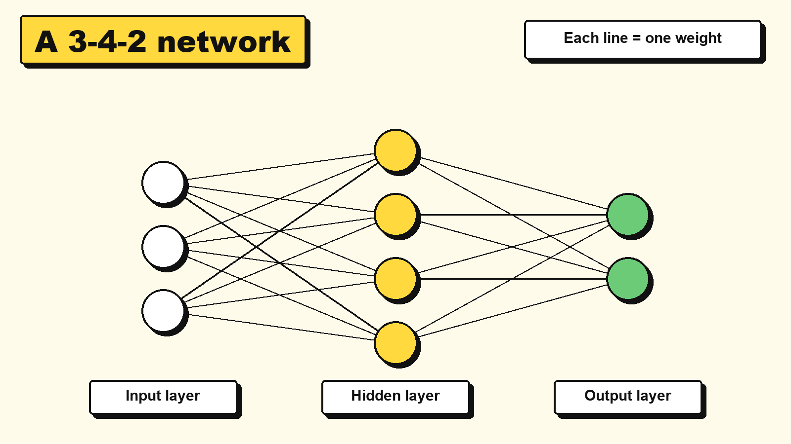
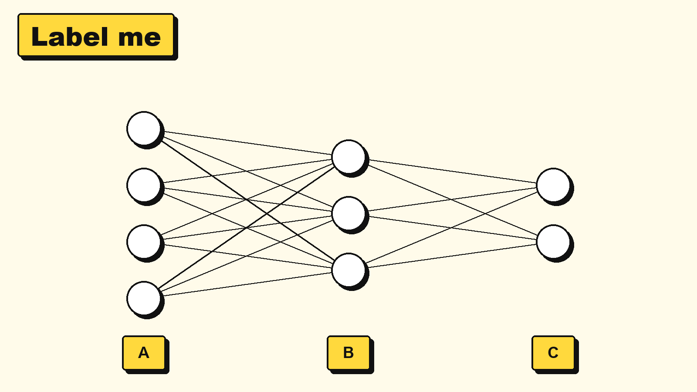

# 3.4 Network architectures and deep learning

> **Part:** 03 Connectionist AI  
> **Author:** Amadeus Kenzie Solihin (first draft by Claude, see AI use at the end)  
> **Reviewer:** Antony Wijaya  
> **Version:** V2.0 (Stage 2, November 2026)  
> **Note:** this chapter covers both "network architectures" and "deep learning and applications" from the module outline (planned as 3.4 and 3.5).

## Learning goals

After this chapter, you can:

1. **Label** the input, hidden and output layers of a network, and **count** its weights.
2. **Trace** an input through a small network, layer by layer.
3. **Explain** why a hidden layer can solve XOR when one perceptron cannot.
4. **Match** a real application to its input data and a suitable type of network.

## Prerequisite knowledge

| You need | Where to learn it |
|---|---|
| How one perceptron computes its output | Chapter 3.2 |
| Training: adjusting weights to lower the loss | Chapter 3.3 |

## Key terms

| Term | Meaning |
|---|---|
| **Neural network** | Many artificial neurons connected together. |
| **Layer** | A group of neurons at the same stage of the network. |
| **Input layer** | Where the numbers enter. It only passes them on and does no calculation. |
| **Hidden layer** | A layer between input and output. People using the network do not see its values. |
| **Output layer** | The layer that gives the final answer. |
| **Feedforward network** | A network where values only move forward, from input to output. |
| **Deep learning** | Using neural networks with many hidden layers. |
| **CNN** (convolutional neural network) | A network designed for grids of data, such as images. |
| **RNN** (recurrent neural network) | A network that reads a sequence one item at a time and keeps a memory of what came before. |
| **Transformer** | A network that uses "attention" to compare all parts of a sequence with each other. Most modern chatbots use it. |
| **Attention** | A way for a model to work out which other words matter most for the current word. |

## 3.4.1 Why does this matter?

Chapter 3.2 ended with a puzzle: one perceptron cannot learn **XOR**, "one or the other, but not both".

XOR is a simple rule, and real problems are much harder. Your phone recognises a face from millions of pixel values. No single neuron could do that.

The fix sounds almost too simple: **connect many neurons together in layers.** How you connect them is the network's **architecture**, and it matters for two reasons:

- More layers let a network build complex ideas from simple ones.
- Different connection patterns suit different kinds of data, such as photos or sentences.

## 3.4.2 The idea

*Diagram: a 3-4-2 feedforward network. Each line is one weight.*

Every network in this chapter has the same basic parts:

- The **input layer** holds the numbers that describe the case.
- Each **hidden layer** takes the previous layer's outputs as its inputs.
- The **output layer** gives the answer.

Each neuron works exactly like the perceptron in Chapter 3.2: multiply, add, apply the activation function. A network has no new kind of magic, just many perceptrons where the output of one is the input of the next.

In a **feedforward** network, values only go forward, with no loops. If every neuron connects to every neuron in the next layer, as in the diagram, we call it **fully connected**.

> 🧠 Everyday picture: a company making a decision. Staff read the raw facts, managers combine the staff reports, and the director makes the final call. Each level works with the summaries from the level below.
>
> ⚠️ Where the picture stops working: nobody assigns jobs to hidden neurons. Their "jobs" appear during training, and they may not match any idea a person would recognise.

## 3.4.3 How it works, step by step

**To run a feedforward network (one forward pass):**

1. Put the input numbers in the input layer.
2. For each neuron in the first hidden layer, compute its output from the inputs, its weights and its bias.
3. Treat those outputs as the inputs to the next layer, and repeat.
4. The last layer's outputs are the answer.

**To count the weights in a fully connected network:**

1. Multiply the sizes of each pair of neighbouring layers.
2. Add those results. That is the number of weights.
3. Every neuron outside the input layer has one bias. Add those too for the total number of learned values.

## 3.4.4 Worked example 1: a hidden layer solves XOR

Here is a 2-2-1 network. All neurons use the step rule from Chapter 3.2: output 1 if the total is greater than 0, otherwise 0.

| Neuron | Layer | Calculation | What it detects |
|---|---|---|---|
| h1 | Hidden | 1·x1 + 1·x2 + 0 | At least one input is on (OR) |
| h2 | Hidden | 1·x1 + 1·x2 - 1 | Both inputs are on (AND) |
| y | Output | 1·h1 + (-1)·h2 + 0 | h1 is on, but h2 is not |

We trace all four cases.

| x1, x2 | h1 total | h1 | h2 total | h2 | y total (h1 - h2) | y | XOR target | Right? |
|---|---|---|---|---|---|---|---|---|
| 0, 0 | 0 | 0 | -1 | 0 | 0 | **0** | 0 | ✅ |
| 0, 1 | 1 | 1 | 0 | 0 | 1 | **1** | 1 | ✅ |
| 1, 0 | 1 | 1 | 0 | 0 | 1 | **1** | 1 | ✅ |
| 1, 1 | 2 | 1 | 1 | 1 | 0 | **0** | 0 | ✅ |

All four are correct. Why does this work? The hidden layer gives the output neuron **two new facts** that are easier to combine: "at least one is on" and "both are on". XOR is then just "the first fact, but not the second".

We picked these weights by hand so you can follow the logic. In real training, backpropagation (Chapter 3.3) finds such weights automatically, and they may look quite different.

## 3.4.5 Worked example 2: how big is a network?

**A small network: 3-4-2** (the diagram in 3.4.2).

| Step | Calculation | Result |
|---|---|---|
| Weights, input to hidden | 3 × 4 | 12 |
| Weights, hidden to output | 4 × 2 | 8 |
| Total weights | 12 + 8 | **20** |
| Biases (hidden + output neurons) | 4 + 2 | **6** |
| Total learned values | 20 + 6 | **26** |

**A network for tiny images.** A small grey picture of 28 × 28 pixels has 784 values. Suppose we use one hidden layer of 128 neurons and 10 outputs (one for each digit, 0 to 9).

| Step | Calculation | Result |
|---|---|---|
| Weights, input to hidden | 784 × 128 | 100,352 |
| Weights, hidden to output | 128 × 10 | 1,280 |
| Total weights | 100,352 + 1,280 | **101,632** |
| Biases | 128 + 10 | **138** |
| Total learned values | 101,632 + 138 | **101,770** |

That is more than 100,000 numbers for a tiny picture and a modest network. Two things follow:

- Nobody could set these by hand, so we need training (Chapter 3.3).
- Nobody can read them to explain a decision, so we have an explainability problem (Chapter 3.6).

## 3.4.6 Different shapes for different data

A fully connected network treats every input separately. It has no idea that two pixels are next to each other, or that one word comes after another. These other architectures build that knowledge in. You only need the main idea of each.

| Type | Best for | Main idea | Everyday picture | Limit |
|---|---|---|---|---|
| **Feedforward** | Fixed lists of numbers, such as a house's size and age | Values move forward through layers | A chain of managers | No built-in idea of position or order |
| **CNN** | Images | Small "filters" slide across the picture looking for the same small pattern everywhere (edges, then shapes, then objects) | Scanning a page with a small magnifying glass | Less suited to long sequences such as text |
| **RNN** | Sequences, such as speech or sentences | Reads one item at a time and carries a memory forward | Reading a story word by word and remembering the plot | Tends to forget the start of long sequences |
| **Transformer** | Long text, and now many other kinds of data | "Attention" compares each word with all the other words at once | Marking a sentence with arrows from "it" to what "it" means | Needs a lot of data and computing power |

## 3.4.7 Deep learning: why many layers, and why now?

**Deep learning** just means using networks with many hidden layers. There is no official number of layers, but more than a few is usually called deep.

**Why many layers?** Each layer builds on the previous one. In an image network, early layers tend to respond to edges, middle layers to shapes, and later layers to whole objects. Nobody programs those stages. They appear in training.

**Why did it take off only recently?** The perceptron is from 1958 and backpropagation was popularised in 1986. Three things came together later:

| What changed | Why it mattered |
|---|---|
| **Big data** | Large networks need huge amounts of examples, and the internet and phones produced them. ImageNet has over a million labelled training images. |
| **Faster hardware** | Graphics chips (GPUs) can do the many multiplications at the same time. |
| **Better methods** | Better activation functions and training tricks made deep networks trainable. |

A famous turning point came in 2012. A deep CNN called AlexNet won the ImageNet image recognition contest, with an error rate of about 15% when the next best entry had about 26%.

### Applications

| Application | Input data | Output | Common architecture |
|---|---|---|---|
| Unlocking a phone with your face | Image | Same person or not | CNN |
| Finding a tumour in a scan | Medical image | Where it is, or how likely | CNN |
| Voice typing | Sound over time | Text | RNN or transformer |
| Translating a sentence | Text in one language | Text in another | Transformer (RNN in older systems) |
| A chatbot | The conversation as text | The next words | Transformer |
| Predicting a house price | A short list of numbers | One number | Feedforward |

## 3.4.8 Common misunderstandings

| Mistake | Why it is wrong | Correct idea |
|---|---|---|
| "A neural network is a copy of the brain." | The neurons are just multiply-and-add steps, inspired loosely by brain cells. | It is a mathematical model, not a digital brain. |
| "The input layer does calculations." | It only holds the input numbers. In the 3-4-2 network, it has no weights of its own and no biases. | Calculation starts at the first hidden layer. |
| "More layers are always better." | They need more data and computing power, and they can overfit (Chapter 3.3). | Choose the smallest network that does the job. |
| "Hidden means secret or unknown to the computer." | The values are ordinary numbers that we can print. | "Hidden" only means it is not the input or the output. |
| "We assign each hidden neuron a job." | We did in 3.4.4, as a teaching example. In real training, the jobs emerge from the data. | Humans choose the architecture. Training chooses the weights. |
| "Deep learning means the AI understands deeply." | "Deep" counts layers. It says nothing about understanding. | Deep = many layers. |

## 3.4.9 Learner activity: label it, run it, match it 🏗️

**Goal:** read a network's structure, trace its output and match architectures to data.  
**You need:** paper and a pen.

### Part A: label and count

1. Which layer is A, which is B and which is C? (input, hidden or output)
2. How many weights does this network have? How many biases? How many learned values in total?
3. **Predict:** if you add a second hidden layer of 3 neurons just after B, does the total go up by more or less than 10? Then calculate it.

### Part B: run a network by hand

This 2-2-1 network uses the step rule: output 1 if the total is **greater than** 0.

| Neuron | Calculation |
|---|---|
| h1 | 2·x1 + 1·x2 - 1 |
| h2 | 1·x1 + 2·x2 - 2 |
| y | 2·h1 + (-1)·h2 - 1 |

Fill in the table, then describe in plain words what rule this network has learned.

| x1, x2 | h1 total | h1 | h2 total | h2 | y total | y |
|---|---|---|---|---|---|---|
| 0, 0 | | | | | | |
| 0, 1 | | | | | | |
| 1, 0 | | | | | | |
| 1, 1 | | | | | | |

### Part C: match the application

For each application, write the **input data** and the **architecture** you would try first (feedforward, CNN, RNN or transformer). Give one reason.

| Application | Input data | Architecture | Reason |
|---|---|---|---|
| 1. Spotting cracks in photos of a bridge | | | |
| 2. Predicting a student's final mark from 5 homework scores | | | |
| 3. A chatbot that answers questions about a long textbook | | | |
| 4. Predicting tomorrow's temperature from the past 30 days, using a simple, small model | | | |

*(Answers are in 3.4.11.)*

## 3.4.10 Check your understanding

**Q1.** A network has layers of size 5-3-1. How many weights does it have? How many biases?

**Q2.** Using the XOR network in 3.4.4, what are h1, h2 and y when x1 = 1 and x2 = 1? Why is h2 needed?

**Q3.** Why can a network with a hidden layer do XOR when one perceptron cannot? Answer in one or two sentences.

**Q4. Find the error.** Sam says: "My network has 10 layers, so it must be more accurate than one with 3 layers." What is wrong?

**Q5.** Which architecture was designed around small filters that slide across an image?
a) RNN  b) CNN  c) Transformer  d) Feedforward

**Q6.** Name the three things that helped deep learning take off.

## 3.4.11 Answers and explanations

**Part A.**

1. **A = input, B = hidden, C = output.**
2. Weights: 4 × 3 + 3 × 2 = 12 + 6 = **18**. Biases: 3 + 2 = **5**. Total: **23**.
3. The new shape is 4-3-3-2. Weights: 12 + 9 + 6 = 27. Biases: 3 + 3 + 2 = 8. Total: **35**. That is **12 more**, so more than 10.

**Part B.**

| x1, x2 | h1 total | h1 | h2 total | h2 | y total | y |
|---|---|---|---|---|---|---|
| 0, 0 | -1 | 0 | -2 | 0 | -1 | **0** |
| 0, 1 | 0 | 0 | 0 | 0 | -1 | **0** |
| 1, 0 | 1 | 1 | -1 | 0 | 1 | **1** |
| 1, 1 | 2 | 1 | 1 | 1 | 0 | **0** |

**The rule: "x1 is on and x2 is off."** Watch the totals of exactly 0: they are not greater than 0, so the output is 0.

**Part C.** Good reasons matter more than one exact answer.

| Application | Input data | Architecture | Reason |
|---|---|---|---|
| 1. Cracks | Images | CNN | A crack is a small visual pattern that can appear anywhere in the picture. |
| 2. Final mark | 5 numbers | Feedforward | A short, fixed list of numbers. Position in an image or order in a sentence does not matter here. |
| 3. Chatbot | Long text | Transformer | Attention helps connect words that are far apart. |
| 4. Temperature | A sequence of 30 numbers | RNN | The order matters, and an RNN reads a sequence step by step. A small feedforward network is a reasonable answer too, if you explain that it gets the 30 values as a fixed list. |

**Q1.** Weights: 5 × 3 + 3 × 1 = **18**. Biases: 3 + 1 = **4**.

**Q2.** h1 = 1, h2 = 1, y total = 1 - 1 = 0, so **y = 0**. Without h2, the network would treat "both on" the same as "one on", which would make it OR, not XOR.

**Q3.** One perceptron can only draw one straight cut through the cases, and XOR needs more than one. The hidden layer creates new facts (here OR and AND) that the output neuron can separate with one cut.

**Q4.** More layers do not guarantee better results. They need more data and can overfit. Accuracy has to be measured on test data.

**Q5.** **b) CNN.**

**Q6.** **Big data**, **faster hardware** (GPUs) and **better methods**.

## 3.4.12 Summary

- A **network** is many perceptrons in layers: **input**, **hidden** and **output**. In a **feedforward** network, values only move forward.
- A hidden layer creates new facts, which is how a network can solve XOR.
- Count the weights by multiplying neighbouring layer sizes and adding the results.
- **CNNs** suit images, **RNNs** read sequences step by step, and **transformers** use attention. Most modern chatbots use transformers.
- **Deep learning** means many hidden layers. It took off thanks to big data, faster hardware and better methods.

## 3.4.13 Links to the rest of the module

| This chapter | Connects to | How |
|---|---|---|
| 3.4 | 2.1 Arrays and records | Each layer's values and weights are stored in arrays. |
| 3.4 | 2.5 Graphs | A network can be drawn as a graph: neurons are nodes, weights are edges. |
| 3.4 | 3.2 The perceptron | Each neuron is a perceptron, and the hidden layer solves its XOR limit. |
| 3.4 | 3.3 How networks learn | Backpropagation trains the hidden layers. |
| 3.4 | 3.6 Ethics and challenges | Huge numbers of weights make decisions hard to explain, and big data raises privacy questions. |

## References

1. Foundations of CS & AI course slides (2024), *Chap 5 Connectionist AI & Big Data Overview*, slide 2 (topic list: Architectures of Neural Networks; Deep Learning and Advanced Concepts; Key Applications).
2. Goodfellow, I., Bengio, Y., & Courville, A. (2016). *Deep Learning.* MIT Press. Chapter 6 (feedforward), Chapter 9 (convolutional), Chapter 10 (recurrent). https://www.deeplearningbook.org/
3. LeCun, Y., Bengio, Y., & Hinton, G. (2015). Deep learning. *Nature, 521*, 436 to 444.
4. Krizhevsky, A., Sutskever, I., & Hinton, G. E. (2012). ImageNet classification with deep convolutional neural networks. *Advances in Neural Information Processing Systems, 25.*
5. Vaswani, A., et al. (2017). Attention is all you need. *Advances in Neural Information Processing Systems, 30.*

*AI use: first draft by Claude (Anthropic) at Kenzie's request. The worked examples and answers were also checked with a small program. See the project log for what was checked and changed.*
