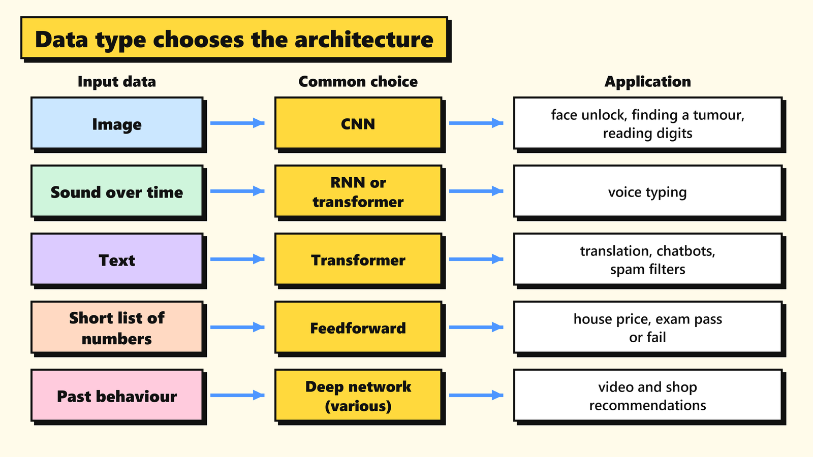
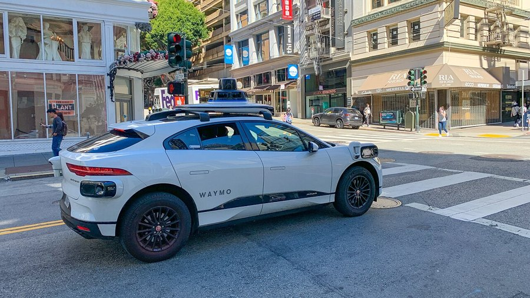
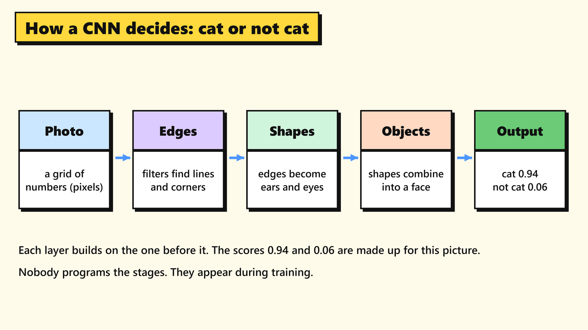
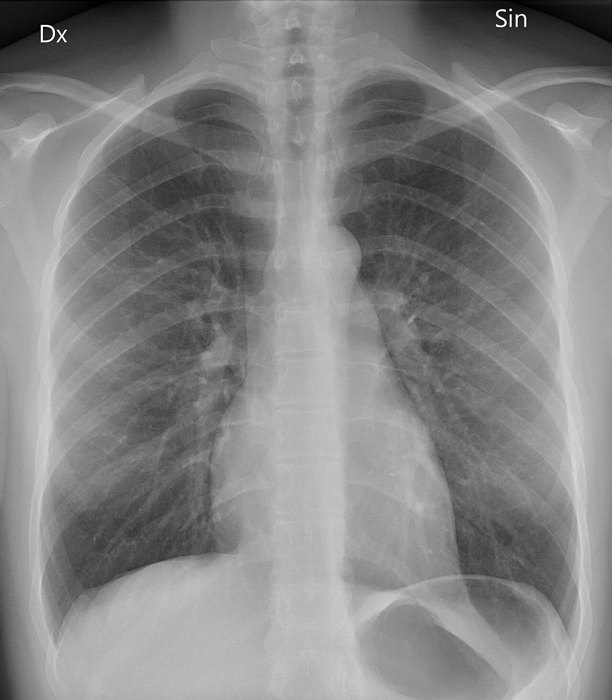

# 3.5 Key applications of connectionist AI

> **Part:** 03 Connectionist AI · **Author:** Amadeus Kenzie Solihin (first draft by Claude) · **Reviewer:** to be named in the pull request
> **Based on:** course slides *Chap 5 Connectionist AI & Big Data*, topic "Key Applications of Connectionist AI"

---

## Learning goals

After this chapter, you should be able to:

1. **Name** five applications of neural networks and the input data each one uses.
2. **Match** an application to a suitable architecture and give a reason.
3. **Describe** the steps from a real problem to a working application.
4. **Calculate** accuracy, misses and false alarms from a small results table.
5. **Judge** when a person must check the model.

## Prerequisite knowledge

Chapter 3.3 (training, test data) and Chapter 3.4 (layers, CNN, RNN, transformer). You only need division and percentages.

## Key terms

| Term | Meaning |
|---|---|
| **Application** | A model used for a real task, together with its data, its users and its checks. |
| **Classification** | Choosing one label from a list, for example "cat" or "not cat". |
| **Miss** | The model says "no" but the answer is "yes". |
| **False alarm** | The model says "yes" but the answer is "no". |
| **Recommendation** | Choosing items that a user will probably like, based on past behaviour. |
| **Human oversight** | A person checks the output and can overrule it. |

## 3.5.1 Why does this matter? (the problem)

Your phone opens when it sees your face. A translator turns a menu into your language. A shop shows you shoes you almost bought. All three use neural networks, but they do not use the **same** network, and they do not fail in the same way.

So the question of this chapter is: **how do people choose, test and use a neural network for a real job?**

## 3.5.2 The idea

Start with the **data**, not with the network. The kind of input decides which architecture is a sensible first choice.

*Diagram: the input data comes first. The architecture follows from it (Chapter 3.4.6).*

| Area | Example | Input | Output | What goes wrong if it fails |
|---|---|---|---|---|
| **Vision** | Reading handwritten digits, face unlock | Image | A label | The wrong person opens the phone |
| **Medicine** | Marking suspicious areas in an X-ray | Medical image | Areas to look at | An illness is missed |
| **Language** | Translation, chatbots | Text | Text | A false sentence sounds true |
| **Speech** | Voice typing | Sound | Text | A name is written wrongly |
| **Recommendation** | Videos, shopping | Past behaviour | A ranked list | You only see more of the same |
| **Driving** | Detecting people and signs | Camera images and other sensors | Objects and distances | A person is not seen |

*Photo: a test car with cameras and other sensors. Source: Daniel Ramirez from Honolulu, USA, [Wikimedia Commons](https://commons.wikimedia.org/wiki/File:Waymo_self-driving_car._%2852194843144%29.jpg), CC BY 2.0, resized.*

> 🧠 Everyday picture: choosing a tool from a toolbox. You look at the job (a screw or a nail) before you take the tool.
>
> ⚠️ Where the picture stops working: a screwdriver works the same in every house. A model may work well in one hospital and badly in the next, because the data there looks different.

## 3.5.3 How it works, step by step

From a problem to an application:

1. **Problem:** say in one sentence what the model must decide, and for whom.
2. **Data:** collect examples with labels. Check who is missing (Chapter 3.6).
3. **Architecture:** choose by the type of data (Chapter 3.4).
4. **Train** on the training data (Chapter 3.3).
5. **Test** on hidden test data, for each group of users.
6. **Use** the model with a rule for when a person must check it.
7. **Watch** it after release. When the world changes, collect new data and train again.

## 3.5.4 Worked example 1: what happens to a cat photo

*Diagram: how a CNN goes from pixels to a label. The scores are invented for this example.*

| Step | What the network has | Example |
|---|---|---|
| Input | A grid of pixel numbers | A 28 × 28 grey picture is 784 numbers |
| Early layers | Places where small patterns appear | An edge at the top left |
| Middle layers | Bigger shapes | Two pointed ears |
| Later layers | Parts of objects | A cat's face |
| Output | One score for each label | cat 0.94, not cat 0.06 |

The application takes the label with the highest score. It also needs a rule for unsure cases, for example: **if the highest score is below 0.70, ask a person.**

## 3.5.5 Worked example 2: is 90% accurate good?

A model looks at 1,000 scans. 50 patients are ill and 950 are healthy. The numbers are invented.

| | Model says ill | Model says healthy | Total |
|---|---|---|---|
| **Really ill** | 45 | 5 (misses) | 50 |
| **Really healthy** | 95 (false alarms) | 855 | 950 |
| Total | 140 | 860 | 1,000 |

| Question | Calculation | Result |
|---|---|---|
| Accuracy | (45 + 855) ÷ 1,000 | **90%** |
| How many ill patients are found? | 45 ÷ 50 | **90%** |
| How many are missed? | 5 ÷ 50 | **10%** |
| If the model says ill, how often is it right? | 45 ÷ 140 | **about 32%** |

Now compare this with a lazy "model" that **always says healthy**: it is right for 950 of 1,000 people, so its accuracy is **95%**. That is higher than 90%, but it finds **no** ill patient at all.

**The lesson:** accuracy alone does not tell you if an application is useful. Count misses and false alarms, and ask which one hurts more. Here a miss is worse, so the model is useful as a **second reader**: a doctor checks all 140 marked scans and is still responsible for the others.

**This has happened in real life.** A 2018 study tested models that find pneumonia in chest X-rays. They often did worse on X-rays from a new hospital than on X-rays from the hospitals they were trained on, and a network could even tell which hospital a picture came from (Zech and others, 2018).

*Photo: a normal chest X-ray, the kind of picture such models read. Source: Mikael Häggström, [Wikimedia Commons](https://commons.wikimedia.org/wiki/File:Normal_posteroanterior_%28PA%29_chest_radiograph_%28X-ray%29.jpg), CC0, resized.*

## 3.5.6 Common misunderstandings

| Mistake | Why it is wrong | Correct idea |
|---|---|---|
| "The newest architecture is the best for every job." | A short list of numbers does not need a transformer. | Choose by the data, then test. |
| "High accuracy means the application is safe." | "Always healthy" had 95% and found nobody. | Look at misses, false alarms and each group. |
| "A chatbot looks up the truth." | It produces likely words. | Check important claims in a reliable source. |
| "Once it is trained, the work is done." | Users, cameras and habits change. | Keep testing after release. |

## 3.5.7 Learner activity: design an application card 📇

**Goal:** plan one application from problem to human check.
**You need:** paper or a text editor. Optional: Google Teachable Machine in a browser with a camera.

**Part A: match.** Choose the best first architecture: feedforward, CNN, RNN or transformer, transformer.

1. Finding cracks in photos of a bridge
2. Predicting a flat's rent from size, floor and age
3. Summarising a long news article
4. Turning a voice message into text

**Part B: count.** A spam filter checks 200 emails. 40 are spam. It catches 36 of them and also blocks 8 good emails. Make the table as in 3.5.5. Find the accuracy, the misses, the false alarms, and the accuracy of a filter that never blocks anything. Which mistake hurts more here?

**Part C: design.** Fill in: problem, input, output, training data, architecture, one thing that could go wrong, who checks it.

**Part D (optional, with Teachable Machine):** train two classes, for example "pen" and "cup", with 30 pictures each, all in front of the **same** background. Predict first: what happens in front of a different background? Then try it and write down the scores before and after. Fallback without internet: think through the same experiment and use the X-ray story in 3.5.5 to predict the result.

## 3.5.8 Check your understanding

1. Why does the choice of network start with the data?
2. A model has 99% accuracy on a disease that affects 1 in 100 people. Why might it still be useless?
3. Name one application where a false alarm is worse than a miss, and explain your choice.

## 3.5.9 Answers and explanations

*Try the activity before you read on.*

**Part A:** 1 CNN (patterns anywhere in an image). 2 Feedforward (a short fixed list of numbers). 3 Transformer (long text). 4 RNN or transformer (sound over time).

**Part B:**

| | Blocked | Not blocked | Total |
|---|---|---|---|
| Spam | 36 | 4 (misses) | 40 |
| Good | 8 (false alarms) | 152 | 160 |

Accuracy: (36 + 152) ÷ 200 = **94%**. A filter that never blocks is right for 160 ÷ 200 = **80%**. A false alarm usually hurts more: a good email, such as a job offer, could be lost, while a missed spam email only costs a moment.

**Part C:** a good card names a specific problem, data that covers all users, an architecture that fits the data, a specific failure and a named human check.

**Part D:** the scores often become less certain or wrong in front of a new background, because the background was part of the training pictures. Better data has several backgrounds.

**Check 1:** the data type decides which patterns the network must find, for example neighbouring pixels or the order of words.
**Check 2:** a model that always says "healthy" also reaches 99%, and it finds nobody.
**Check 3:** for example a spam filter (a lost job offer) or automatic account blocking. The reason counts.

## 3.5.10 References

1. Foundations of CS & AI course slides (2024): *Chap 5 Connectionist AI & Big Data Overview*, slide 2.
2. LeCun, Y., Bengio, Y., & Hinton, G. (2015). Deep learning. *Nature*, 521, 436-444. https://doi.org/10.1038/nature14539
3. Zech, J. R., and others (2018). Variable generalization performance of a deep learning model to detect pneumonia in chest radiographs: A cross-sectional study. *PLOS Medicine*, 15(11), e1002683. https://doi.org/10.1371/journal.pmed.1002683
4. Google. *Teachable Machine*. https://teachablemachine.withgoogle.com/

## 3.5.11 Links to the rest of the module

| From | To | Link |
|---|---|---|
| 3.3 How networks learn | 3.5 | Test data shows if the application is ready |
| 3.4 Architectures | 3.5 | The data type chooses the architecture |
| 3.5 | 3.6 Ethics | Misses and false alarms must be fair for every group |
